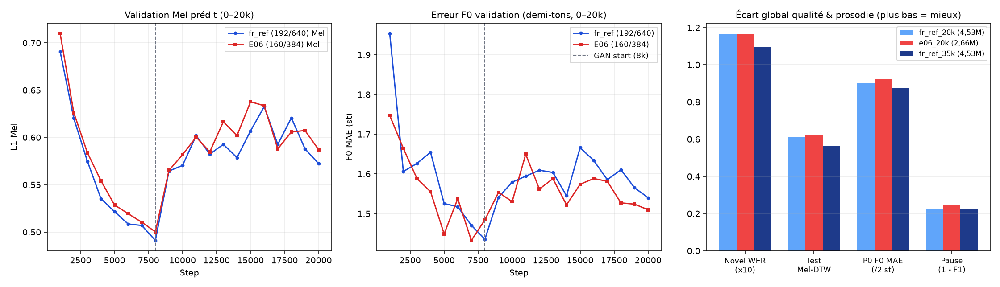
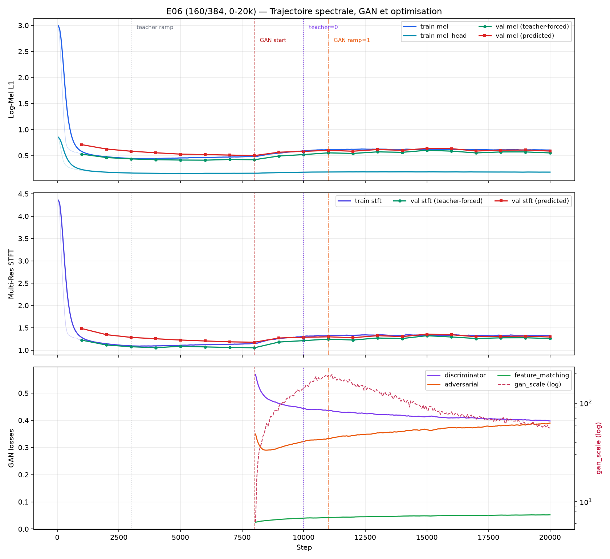
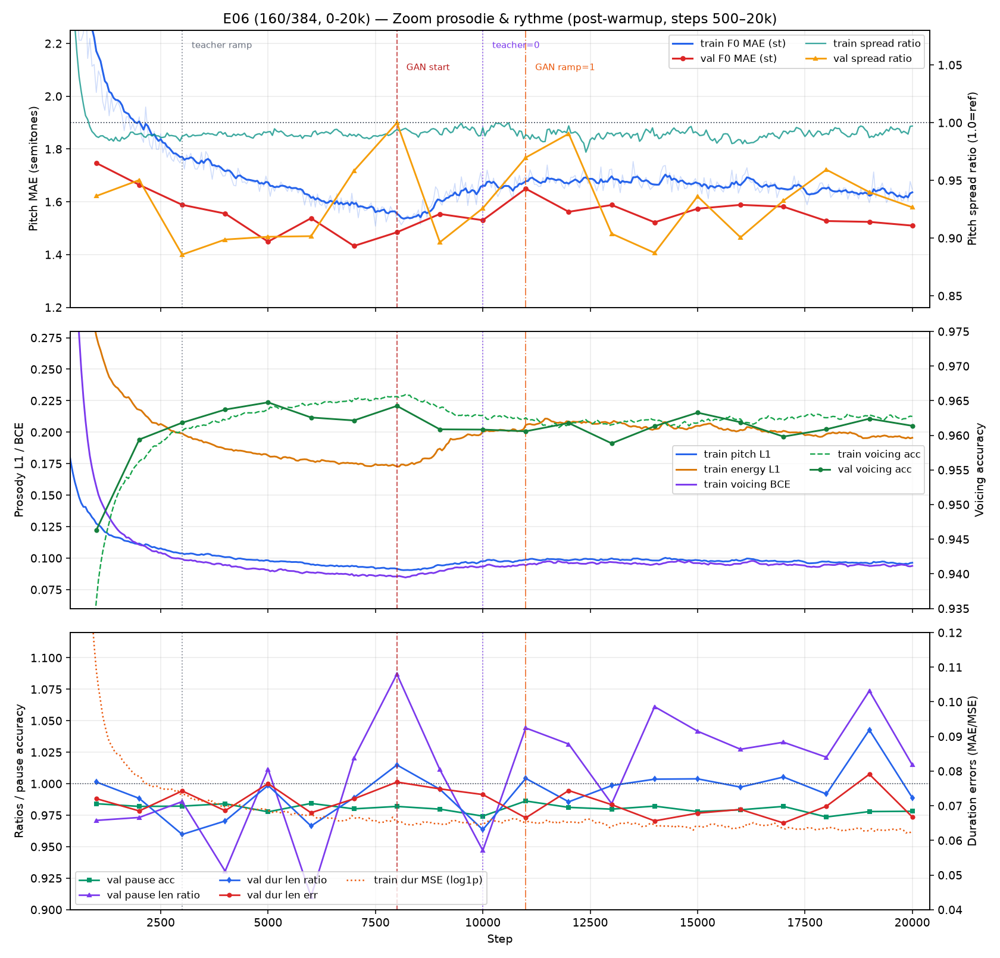

# E06 & Feuille de route entraînement — Architecture compacte (`2,66 M`) et comparaison `160/384` vs `192/640`

- **Statut** : **ENTRAÎNÉE `0 → 20 000` pas & ÉVALUÉE (Livrable 5 complet)** — Comparaison directe à données (`annotations_e01`), hyperparamètres et `seed = 20261113` identiques contre `fr_ref_20k` (`4,53 M @ 20k`), et mise en perspective face à `fr_ref_35k` (`4,53 M @ 35k`). **Arrêt strict respecté à `20 000` pas (`fr_ref_35k` conservée comme référence qualité).**
- **Branche** : `fr`
- **Budget GPU Colab `L4` réellement consommé (`E06`)** : **`6,24` unités Colab** (`80,52 → 74,28` u., dans le plafond de `8,0` u. ; entraînement `10 122,40 s` + évaluation + rapatriement, VM arrêtée et `0` session active). *(Préparation CPU : `0` u.)*

---

## 1. Comparaison architecturale locale (`CPU`, `omit_mask=True`, `0` entraînement GPU)

### 1.1 Paramètres et taille ONNX FP32

| Configuration | Fichier config | `channels` | `heads` (`dim/tête`) | `feedforward` | Params inférence | Params `mel_head` | `.onnx` FP32 (`omit_mask=True`) | Nœuds ONNX |
|---|---|---:|---:|---:|---:|---:|---:|---:|
| **Référence FR (`192/640`)** | [fr_baseline_192_640.json](../../configs/fr_baseline_192_640.json) | 192 | 4 (`48`) | 640 | `4 533 067` | `15 440` | `21 307 929 o` (`21,31 MB`) | 2 217 |
| **E06 compacte (`160/384`)** | [e06_160_384.json](../../configs/e06_160_384.json) | 160 | 4 (`40`) | 384 | **`2 657 899`** (`-41,37 %`) | `12 880` | **`13 813 353 o` (`13,81 MB`, `-35,17 %`)** | 2 217 |

*(La diminution sur `.onnx` est de `-35,17 %` et non `-41,37 %` car les noyaux fixes STFT/cepstre ~`2,87 MB` sont identiques entre les deux architectures. L'empreinte acoustique `Config.acoustic_fingerprint` reste strictement identique : les tenseurs `.pt` qualifiés E05 sont réutilisables à 100 %.)*

### 1.2 Latences CPU ONNX Runtime (`CPUExecutionProvider`, `ORT_ENABLE_ALL`)

Mesures sur **Intel Core i7-3770 @ 3.40 GHz** (Ivy Bridge sans AVX2/VNNI), script [benchmark_e06_arch.py](../../scripts/benchmark_e06_arch.py), `warmup = 5`, `runs = 30`, passes séquentielles isolées (aucune autre tâche active en parallèle ; biais durée non entraîné fixé à `[1.6, 1.0]` pour produire des longueurs réalistes : `short = 0,811 s`, `medium = 2,560 s`, `long = 5,632 s`) :

- **1 thread** (`loadavg` : `4,71 → 4,57`) :

| Phrase (`tokens`, `durée`) | Réf. `192/640` Méd / Min / p95 (`ms`) | Réf. `RTFx` | E06 `160/384` Méd / Min / p95 (`ms`) | E06 `RTFx` | Gain médian |
|---|---:|---:|---:|---:|---:|
| `short` (`19`, `0,811 s`) | `32,86` / `30,77` / `38,33` | `24,7x` | **`28,04`** / `24,11` / `40,28` | **`28,9x`** | **`-14,7 %`** |
| `medium` (`60`, `2,560 s`) | `101,68` / `97,76` / `119,37` | `25,2x` | **`77,33`** / `75,00` / `81,00` | **`33,1x`** | **`-23,9 %`** |
| `long` (`132`, `5,632 s`) | `286,15` / `261,09` / `323,51` | `19,7x` | **`215,34`** / `200,84` / `229,35` | **`26,2x`** | **`-24,7 %`** |

- **4 threads** (`loadavg` : `4,75 → 4,51`) :

| Phrase (`tokens`, `durée`) | Réf. `192/640` Méd / Min / p95 (`ms`) | Réf. `RTFx` | E06 `160/384` Méd / Min / p95 (`ms`) | E06 `RTFx` | Gain médian |
|---|---:|---:|---:|---:|---:|
| `short` (`19`, `0,811 s`) | `18,75` / `13,68` / `28,65` | `43,2x` | **`14,69`** / `11,77` / `16,42` | **`55,2x`** | **`-21,7 %`** |
| `medium` (`60`, `2,560 s`) | `45,86` / `41,35` / `58,23` | `55,8x` | **`41,22`** / `34,16` / `57,64` | **`62,1x`** | **`-10,1 %`** |
| `long` (`132`, `5,632 s`) | `118,85` / `104,92` / `146,65` | `47,4x` | **`98,26`** / `87,78` / `114,76` | **`57,3x`** | **`-17,3 %`** |

*(Constat : même avec une baisse de `-41,4 %` de paramètres, l'accélération réelle FP32 sur CPU se situe entre `-10 %` et `-25 %` car l'attention $O(T^2)$ et les convolutions STFT pèsent d'autant plus une fois les projections linéaires allégées. L'option INT8 `acoustic_stack` et le DSP C restent expérimentaux hors défaut `.onnx`, sans nouvelle campagne d'optimisation à ce stade.)*

---

## 2. Priorité 3 — Budget mesuré et critères d'arrêt pour la référence TTS française (`fr_baseline_192_640`)

### 2.1 Base empirique mesurée sur Colab `L4` (`opt1-1117/out/run_info/metrics.jsonl`)

Sur la VM Colab **`L4`** à **`1,94` unités/h** (`batch_frames = 9000`, `max_batch = 32`, `crop_samples = 8192`, `crops = 2`, données `fr` format `4`) :
- **Phase pré-GAN (`step <= gan_start`)** : médiane mesurée **`9,1 steps/s`** (`~1 000` steps en `110 s`).
- **Phase GAN (`step > gan_start`)** : médiane mesurée **`1,28 steps/s`** (`~4 608 steps/h`).

> [!IMPORTANT]
> **Règle de coût GPU sur `features/`** : Ne jamais exécuter `tiny_voca.prepare` (`librosa.pyin` CPU séquentiel) sur une VM GPU `L4` (ce qui avait coûté `~98 min ≈ 3,17` unités sur le run précédent). Préparer les `.pt` manquants de `train` (`~2,8 Go` au complet) en local CPU (`0` unité) ou en archive avant d'ouvrir la session GPU d'entraînement.

### 2.2 Découpage par paliers avec critères d'arrêt stricts (`seed = 20261113`, données qualifiées E05)

Recette standard alignée sur `train.py` (`--gan-start 8000 --teacher-hold 3000 --teacher-ramp 7000 --teacher-final 0 --gan-ramp 3000 --gan-ratio 0.7 --keep-every 5000`, `train` = `fr4k` qualifié E05, entraînement avec masquage de padding complet — jamais `omit_mask=True` en batch paddé) :

| Palier | Plage de steps | Durée GPU `L4` estimée | Coût `L4` estimé (`1,94/h`) | Critère d'évaluation & arrêt |
|---|---|---:|---:|---|
| **Palier 1 — Référence initiale (arrêt obligatoire à 20k)** | `0 → 20 000` (`8k` pré-GAN + `12k` GAN) | `~15 min + 2h36 = ~2h51` *(+ transfert/éval `~20 min`, plafond `3h30`)* | **`~5,5` unités** *(max `~6,8` u.)* | Exécuter `tiny_voca.evaluate` sur `test` + `novel`. **Arrêt définitif si `validation_predicted_mel` stagne/diverge ou si effondrement des durées/GAN**. Débloque **E02** si `novel WER <= 0,15`. |
| **Palier 2 — Extension qualité conditionnelle (`--resume`)** | `20 000 → 35 000` (`+15k` GAN) | `~3h15` *(plafond `3h45`)* | **`~6,3` unités** *(max `~7,3` u.)* | Uniquement si le Palier 1 montre une amélioration nette mais perfectible (`0,08 < novel WER <= 0,20`, pertes `mel/stft` encore décroissantes). |
| **Palier 3 — Maturation finale optionnelle (`--resume`)** | `35 000 → 50 000` (`+15k` GAN) | `~3h15` *(plafond `3h45`)* | **`~6,3` unités** *(max `~7,3` u.)* | Uniquement si Palier 2 justifie la convergence finale (nota : les `104 000` steps du README anglais coûteraient `~21 h ≈ 41` unités sur `L4` sans paliers). |

---

## 3. Priorité 4 — Condition de reprise d'E02

Conformément à [E02-prosody-calibration.md](E02-prosody-calibration.md), **E02** ne reprend qu'après validation du Palier 1 (ou 2) de la référence française (`novel WER <= 0,15` dans `report.json`), via :

```bash
PYTHONPATH=src:scripts ./env/bin/python scripts/eval_e02_prosody.py \
  --checkpoint <fr4k_ref_inference.pt> \
  --report <fr4k_ref_report.json> \
  --out-dir .local-runs/e02_fr4k_ref
```

---

## 4. Priorité 5 — Protocole comparatif E06 (`160/384`) vs Référence (`192/640`)

Pour éviter tout biais, **E06 (`2,66 M`)** sera entraînée **strictement à données et protocole identiques** après validation du Palier 1 de la référence :
- **Données** : exactement les mêmes manifestes `annotations_e01/{train,validation,test}.jsonl` et le même `seed = 20261113`.
- **Hyperparamètres** : `--config configs/e06_160_384.json`, même `--batch-frames 9000 --max-batch 32 --gan-start 8000 --teacher-hold 3000 --teacher-ramp 7000 --gan-ramp 3000`, comparée au même palier `20 000` steps (coût `L4` attendu `<= ~5,5` unités, potentiellement légèrement inférieur à `5,5` u. grâce au coût Transformer réduit).
- **Critères d'évaluation E06 vs Référence (`192/640`)** :
  1. `validation_predicted_mel` et `validation_predicted_stft` au même nombre de steps (`20k`).
  2. Intelligibilité `tiny_voca.evaluate` : `novel WER` et `test WER` (`faster-whisper`).
  3. Qualité acoustique (`mel_dtw`, `pitch_std`, `duration_ratio`, écoute comparative en aveugle).
  4. Gain d'efficience : débit `steps/s` / coût GPU réel + latence ONNX CPU (`1T` / `4T`, FP32 `13,81 MB`, et variante `int8_acoustic` en annexe expérimentale).
  5. **Décision** : adopter `160/384` seulement si la baisse de paramètres (`-41,4 %`) et de latence (`-10 %` à `-25 %`) ne dégrade pas l'intelligibilité ni la naturalité perceptuelle.

---

## 5. Livrable 5 — Résultats E06 (`20 000` pas) vs `fr_ref_20k` (`20k`) et `fr_ref_35k` (`35k`)

### 5.1 Reproductibilité, empreintes et coût GPU observé

- **Configuration** : [e06_160_384.json](../../configs/e06_160_384.json) (`2 657 899` paramètres d'inférence, `format_version = 4`, `rules_version = 2`).
- **Artefacts locaux vérifiés** (`75/75 SHA256SUMS OK`, `load_model(..., check_frontend=True)` valide) :
  - `e06_20k_final/inference.pt` (`sha256` : `5dd8b9c88fc2e3dfe2244245392dbedb26f2b7a74311bff10b7d4268f630851c`, `step = 20000`)
  - `e06_20k_final/last.pt` (`sha256` : `0230ea72e31d3a610c20dc87c38a3d8cadac8e4e3bf5091f93d817d9c8b16585`, `step = 20000`)
- **Coût GPU Colab `L4` et débit réel** :

| Modèle (`params`) | Steps | Pré-GAN `0 → 8k` (`steps/s` @ 8k) | GAN `8k → 20k` (`steps/s` @ 20k) | Temps total entraînement | Unités Colab |
|---|---:|---:|---:|---:|---:|
| **`fr_ref_20k` (`4,53 M`)** | `0 → 20 000` | `914,84 s` (`8,63 steps/s`) | `9 293,57 s` (`1,293 steps/s`) | `10 208,41 s` (`2h 50m`) | `6,15` u. |
| **`e06_20k` (`2,66 M`)** | `0 → 20 000` | `859,65 s` (`9,36 steps/s`, `-6,0 %`) | `9 262,75 s` (`1,297 steps/s`, `-0,3 %`) | `10 122,40 s` (`2h 49m`) | **`6,24` u.** |

> [!NOTE]
> **Constat coût GPU** : réduire le générateur de `-41,4 %` accélère légèrement le pré-GAN (`+8,4 %` en `steps/s`), mais **n'économise quasiment ni temps ni budget GPU sur `L4` (`-0,8 %` global)**, car les discriminateurs multi-périodes/multi-échelles (MPD/MRD) et les pertes STFT/Mel dominent le temps par step en phase GAN (`~1,30 steps/s`).

### 5.2 Courbes d'apprentissage (`0 → 20k`), validation, WER et latence CPU réelle



<details>
<summary>Courbes détaillées E06 0→20k (spectre/GAN et prosodie/rythme)</summary>




</details>

- **Perturbations validation `0 → 20k` et intelligibilité (`tiny_voca.evaluate`, `faster-whisper small`)** :

| Métrique | `fr_ref_20k` (`4,53M @ 20k`) | `e06_20k` (`2,66M @ 20k`) | `fr_ref_35k` (`4,53M @ 35k`) | Écart `e06_20k` vs `fr_ref_20k` |
|---|---:|---:|---:|---:|
| `val_predicted_mel` (pas final) | `0,5723` | `0,5871` | **`0,5156`** | `+0,0148` (`+2,6 %`) |
| `val_predicted_stft` (pas final) | `1,2817` | `1,2956` | **`1,2030`** | `+0,0139` (`+1,1 %`) |
| `val_pitch_error_semitones` (val 32 phr.) | `1,5401` | `1,5098` | **`1,4895`** | `-0,0303 st` |
| **`novel WER` (`16` phrases hors corpus)** | `0,1165` (`F1 0,1206 / M1 0,1123`) | **`0,1163`** (`F1 0,1302 / M1 0,1024`) | **`0,1096`** (`F1 0,1118 / M1 0,1074`) | `-0,0002` *(iso)* |
| **`test WER` (`8` phrases, réf `0,0491`)** | `0,0893` (`F1 0,0312 / M1 0,1473`) | **`0,0670`** (`F1 0,0312 / M1 0,1027`) | **`0,0402`** (`F1 0,0312 / M1 0,0491`) | `-0,0223` |
| `validation WER` (`8` phr., réf `0,1990`) | `0,2020` | `0,1841` | `0,1841` | `-0,0179` |
| `train WER` (`8` phr., réf `0,0677`) | `0,0573` | `0,0773` | `0,0573` | `+0,0200` |
| `test mel_dtw` (8 phr.) / `pause_ratio` | `0,6146` / `1,0272` | `0,6375` / `0,9065` | **`0,5557`** / `0,9856` | `+0,0229` / `-0,1207` |

- **Export ONNX FP32 réel (`omit_mask=True`) et latences CPU mesurées sur checkpoints entraînés** (`2 167` nœuds ; 3 phrases françaises réelles `short=19 tok (~2,0s)`, `medium=59 tok (~4,1s)`, `long=132 tok (~8,15s)` ; `warmup=5, runs=30`, `loadavg 1,78 → 3,05`) :
  - **Taille `.onnx` FP32** : `21,34 MB` (`fr_ref_20k`) → **`13,84 MB` (`e06_20k`, `-35,1 %`)**.
  - **1 thread (`1T`)** :
    - `short` : `77,11 → 62,05 ms` (`-19,5 %`, `RTFx 26,0x → 33,4x`)
    - `medium` : `183,70 → 131,45 ms` (`-28,4 %`, `RTFx 23,1x → 30,8x`)
    - `long` : `437,75 → 346,14 ms` (`-20,9 %`, `RTFx 18,7x → 23,5x`)
  - **4 threads (`4T`)** :
    - `short` : `41,46 → 31,43 ms` (`-24,2 %`, `RTFx 48,4x → 65,8x`)
    - `medium` : `77,93 → 56,68 ms` (`-27,3 %`, `RTFx 54,5x → 71,5x`)
    - `long` : `173,13 → 149,48 ms` (`-13,7 %`, `RTFx 47,2x → 54,4x`)

### 5.3 Évaluation d'expressivité P0 (`40` phrases `test` appariées, `20 F1 + 20 M1`, `0` GPU)

Mesurée avec exactement le même protocole (`scripts/eval_p0_prosody.py`, YIN non biaisé, warping phonémique et contrefactuels `A/B/C/D`) :

| Mode / Axe | Métrique | `fr_ref_20k` (`4,53M @ 20k`) | `e06_20k` (`2,66M @ 20k`) | `fr_ref_35k` (`4,53M @ 35k`) | Référence humaine |
|---|---|---:|---:|---:|---:|
| **`A_free`** | `mel_dtw` (global) | `0,6096` | `0,6211` | **`0,5637`** | — |
| **`D_oracle_full`** | `mel_dtw` / `stft_loss` *(capacité décodeur+vocodeur)* | `0,5075` / `1,2752` | `0,5148` / `1,2865` | **`0,4483`** / **`1,1919`** | — |
| **`A_free`** | `f0_mae_st` (**all** / `F1` / `M1`) | `1,806` / `1,654` / `1,959` | `1,848` / **`1,635`** / `2,060` | **`1,747`** / `1,666` / **`1,827`** | — |
| **`A_free`** | `f0_corr` / `f0_slope_mae (st/s)` | **`0,7314`** / `35,31` | `0,7130` / `36,85` | `0,7132` / **`34,48`** | — |
| **`A_free`** | `end_delta_abs_err_st` (all / `M1`) | **`1,521`** / **`1,966`** | `1,791` / `2,134` | `1,640` / `2,008` | — |
| **`A_free`** | `gen_f0_std_st` / `local_std_st` | `2,745` / `1,085` | `2,786` / `1,157` | `2,593` / `1,070` | `2,577` / `1,045` |
| **`A_free`** | `accent_prom_st` | `2,714` | **`2,830`** | `2,715` | `3,101` |
| **`A_free`** | `voicing_agreement` (all / `M1`) | `0,8708` / `0,7997` | `0,8486` / `0,7529` | **`0,8927`** / **`0,8392`** | — |
| **`A_free`** | `gen_vowel_voiced` (`M1`) | `0,8189` | `0,7487` | **`0,8750`** | `0,9000` |
| **`A_free`** | `energy_corr` (all / `M1`) | `0,8639` / `0,8361` | `0,8450` / `0,8077` | **`0,8664`** / **`0,8435`** | — |
| **Rythme** | `phone_mae_ms` / `rel_dur_mae` | `12,82 ms` / `0,1647` | **`12,44 ms`** / **`0,1591`** | `13,00 ms` / `0,1657` | — |
| **Rythme** | `pre_pausal_ratio` / `local_rate_cv` | `1,645` / `0,1533` | `1,668` / `0,1528` | **`1,707`** / **`0,1589`** | `1,809` / `0,1875` |
| **Rythme** | `pause_f1` / `pause_recall` / `pause_tp_mae` | **`0,7778`** / **`0,8235`** / `90,1 ms` | `0,7536` / `0,7647` / `101,9 ms` | `0,7761` / `0,7647` / **`86,6 ms`** | — |
| **Gradients `P0.C`** | `prosody_stack` (`gan_only` vs `prosody_only`) | `17,46` vs `0,52` (`gan_scale=45,7`) | `16,52` vs `0,59` (`gan_scale=58,3`) | `2,01` vs `0,52` (`gan_scale=5,5`) | — |

### 5.4 Diagnostic scientifique et décision sur `160/384` vs `192/640`

1. **La capacité acoustique compacte (`2,66 M`) n'est pas le goulot d'étranglement principal** : à prosodie oracle égale (`D_oracle_full` à `20k`), `160/384` est à **`+0,0073 mel_dtw` (`+1,4 %`)** de `192/640` (`0,5148` vs `0,5075`), alors que les `+15k` steps de maturation (`fr_ref_20k → fr_ref_35k`) apportent **`-0,0592 mel_dtw` (`~8×` plus grand)**. L'intelligibilité hors corpus (`novel WER 0,1163 vs 0,1165`) et la durée phonémique (`12,44 ms vs 12,82 ms`) sont intactes.
2. **Mais la compression pénalise d'abord la prosodie fine et le voisement sur `M1`** : malgré une dispersion brute F0 plus élevée (`std 2,786 st`, `local_std 1,157 st`), l'erreur F0 alignée (`M1 2,060 st`, terminaisons `2,134 st`), le voisement vocalique (`M1 74,9 %` vs `81,9 %` à `20k` / `87,5 %` à `35k` vs `90,0 %` réf.) et le rappel/durée des pauses (`pause F1 0,7536`, `M1 MAE 114,7 ms`) se dégradent — confirmant expérimentalement qu'**une variance F0 plus haute sans meilleur alignement prosodique n'est pas un gain d'expressivité**.
3. **Le défaut structurel `P0.C` est identique dans les deux architectures** : à `20 000` pas sur E06, les pertes GAN injectent une norme de gradient `16,52` dans `prosody_stack` contre `0,59` pour les pertes prosodiques (`~28×`), produisant la même cassure à `step = 8000` sur les courbes de validation F0 et d'énergie.
4. **Décision** :
   - **Conserver `fr_ref_35k` (`192/640`, `4,53 M`) comme référence principale** (aucune extension E06 au-delà de `20k` à ce stade).
   - **Prioriser P4 (fine-tuning ciblé P2 sur le modèle `192/640` en détachant `prosody_hidden` des pertes spectrales/GAN + supervision ΔF0/rythme)** — c'est là que réside le principal levier expressif, indépendamment de la largeur Transformer.
   - **Garder `160/384` (`e06_20k`) validée comme architecture compacte de repli / edge CPU** (`13,84 MB`, `-20 %` à `-28 %` de latence `1T`), à ré-entraîner avec la recette prosodique corrigée **uniquement après validation de P4** si une cible embarquée/CPU l'exige.
