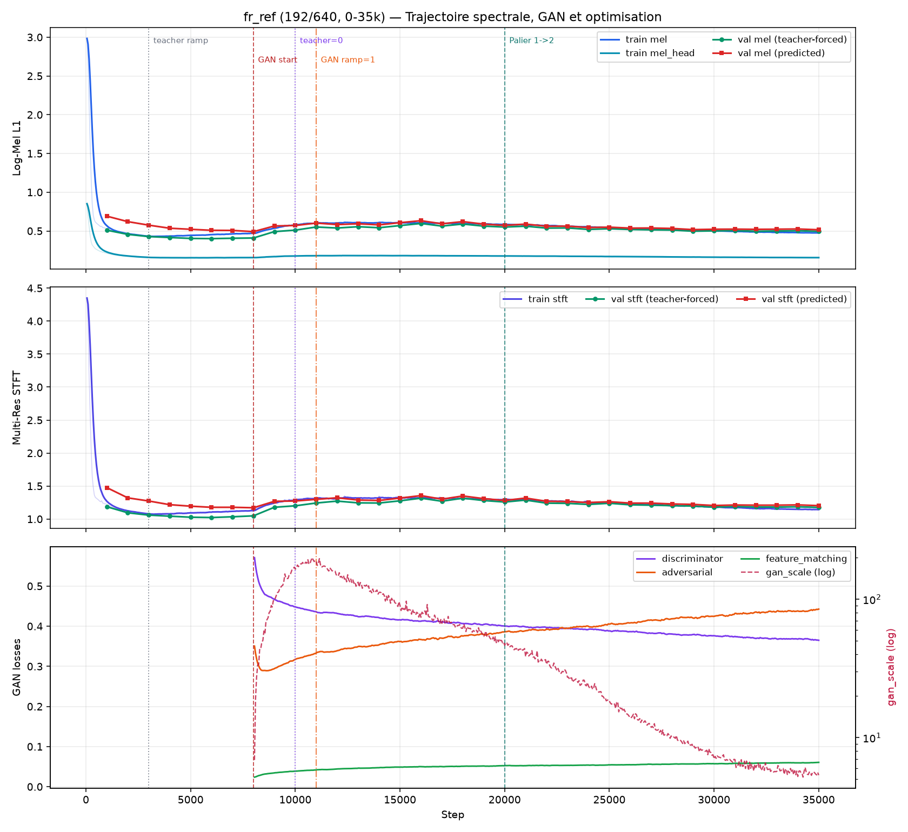
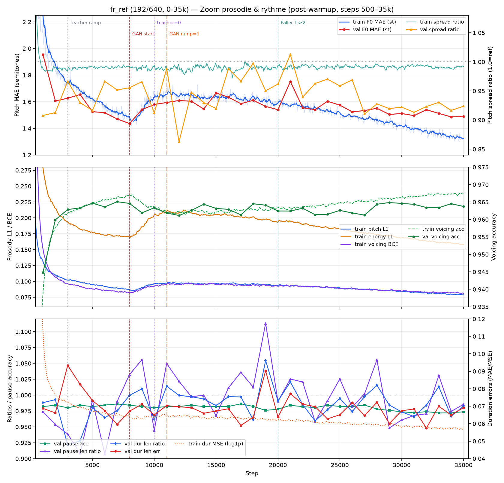
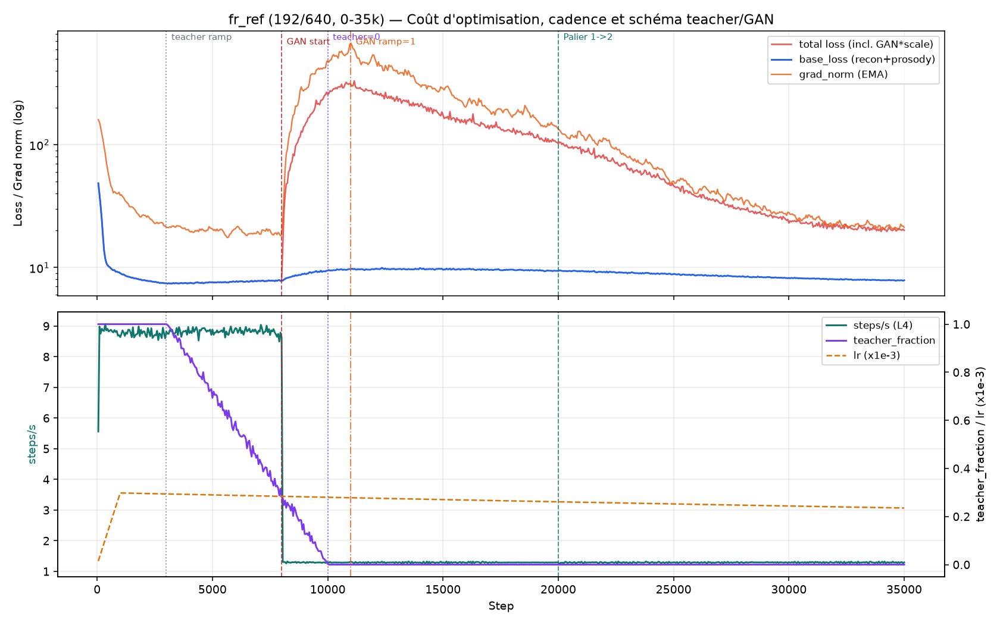
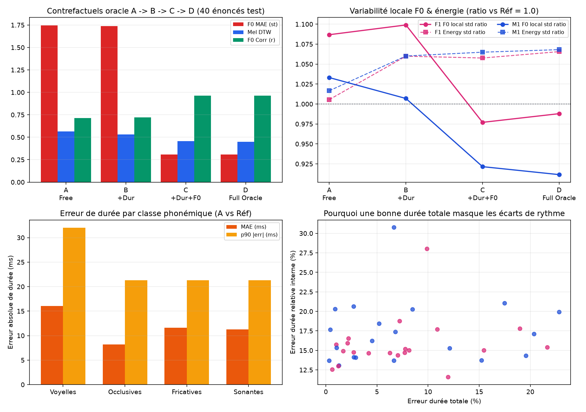
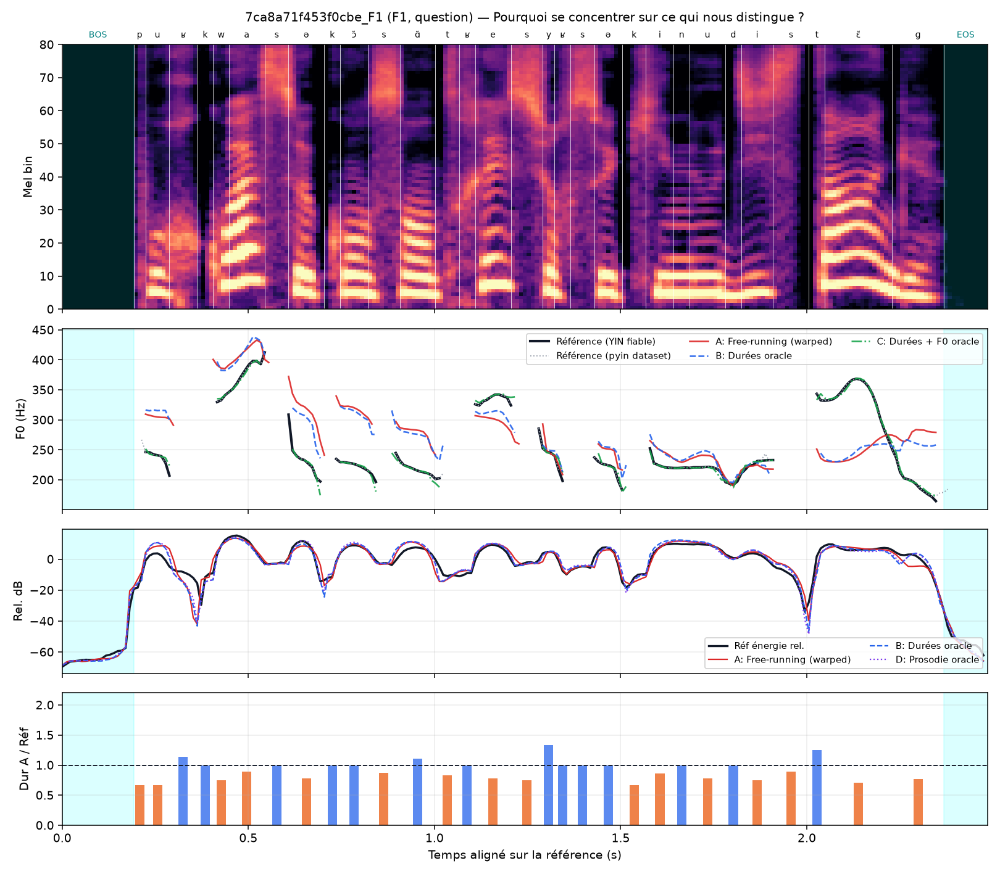
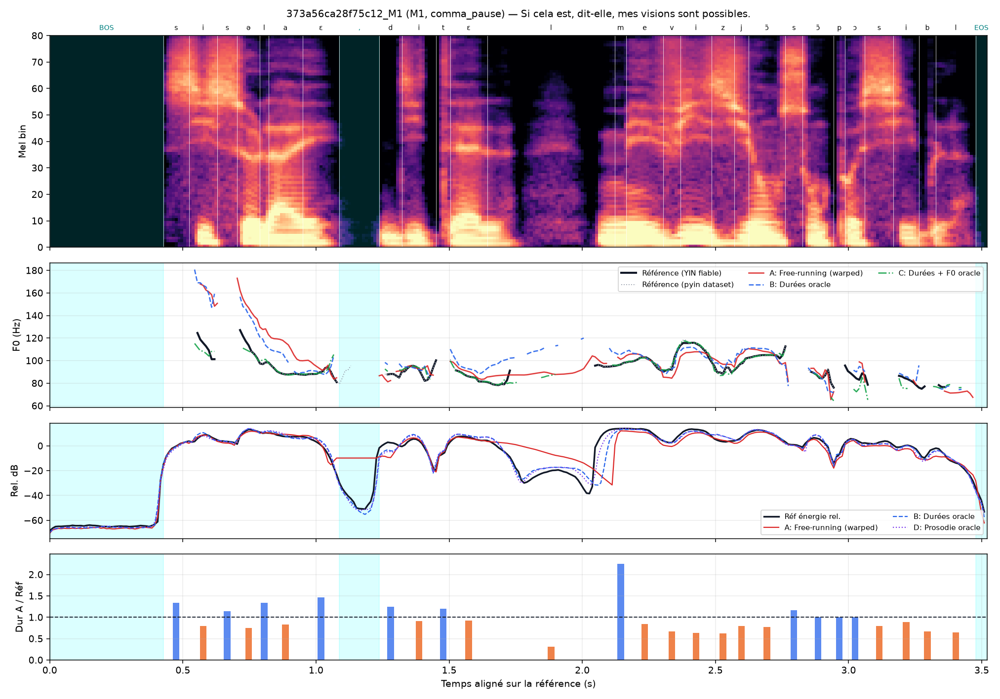

# P0 / P1 / P2 — Diagnostic d'expressivité prosodique (0 GPU) et plan de remédiation

- **Statut** : **DIAGNOSTIC P0 & VÉRIFICATION P1 TERMINÉS (`0` unité GPU Colab)**
- **Branche / dépôt** : `fr` (`yoch/tiny-voca`)
- **Modèle analysé** : `fr_ref_35k` ([inference.pt](../../.local-runs/colab/fr_ref_35k/fr_ref_35k_final/inference.pt), `step = 35 000`, `4 533 067` paramètres, `sha256: c2bb29b9...` ; [last.pt](../../.local-runs/colab/fr_ref_35k/fr_ref_35k_final/last.pt), `sha256: b1fbb3a4...`)
- **Corpus d'analyse indépendant** : `40` enregistrements appariés `test` (`20` textes × `2` voix `F1`/`M1`, `0` recouvrement avec `train`), répartis équitablement sur `plain_assert`, `question`, `exclamation`, `comma_pause` ([p0_report.json](../../.local-runs/p0_expressivity/p0_report.json))

---

## 1. Livrable 1 — Courbes complètes `0–35k` (`metrics.jsonl`)

Générées par [plot_training_curves.py](../../scripts/plot_training_curves.py) depuis les **700 points réels** de [metrics.jsonl](../../.local-runs/colab/fr_ref_35k/fr_ref_35k_final/metrics.jsonl) (Palier 1 `10 208,41 s` + Palier 2 `11 619,79 s` sur L4) :

### Faits démontrés sur la trajectoire `0–35k`

1. **Discontinuité franche à `GAN start` (`step = 8 000 → 11 000`) :**
   - À `step = 8 000` (fin du pré-GAN), `val_mel_tf = 0.4092`, `val_mel_pred = 0.4911`, `val_f0_err = 1.4358 st`, `val_spread_ratio = 0.9555`, `val_pause_acc = 0.9841`, `val_dur_err = 0.0672`.
   - Dès l'allumage du GAN (`step = 8 000 → 11 000`), `gan_scale` monte jusqu'à **`~180+`** (`loss` passe de `7.81` à `> 310`, `grad_norm` dépasse `600` avant clipping à `10`), provoquant un rebond simultané de `val_mel_pred` (`0.4911 → 0.6069` à `15k`), `val_f0_err` (`1.4358 → 1.6661 st` à `15k`) et `energy L1` (`0.168 → 0.21`).
2. **Convergence spectrale vs stagnation prosodique (`20k → 35k`) :**
   - `val_mel_pred` (`0.5723 → 0.5156`) et `val_stft_pred` (`1.2817 → 1.2030`) continuent de baisser régulièrement jusqu'à `35 000`.
   - En revanche, **`train F0 MAE` baisse (`1.61 → 1.32 st`) tandis que `val F0 MAE` plafonne à `1.4895 st`** (toujours supérieur à `step = 8 000`), **`val spread ratio` s'installe vers `0.91–0.93`**, et `val dur len err` (`0.0692` à `35k` vs `0.0672` à `8k`) comme `val pause acc` (`0.9738` vs `0.9841`) ne progressent plus après `8k`.

---

## 2. Livrable 2 — Fiabilité F0 et diagnostic apparié de l'écart d'expressivité (P0.A)

### 2.1 Validation de l'estimateur F0 (biais `pyin` E05 évité)

Pour éviter le retard d'attaque et les décrochages `pyin` sur voix grave `M1` documentés en [E05](E05-aligner-qualification.md), [p0_expressivity.py](../../scripts/p0_expressivity.py) extrait un contour F0 identique sur la référence et chaque synthèse via **YIN (`frame_length = 1024`, `hop = 256`, centré)** + **harmonicité par autocorrélation passe-bas phase nulle (`< 1,2 kHz`, seuil `0.55`)** + seuil d'énergie relatif (`-38 dB`) + filtrage médian d'octave (`continuous_pitch`).

- Vérification sur impulsions synthétiques glissantes ([test_p0.py](../../tests/test_p0.py)) : erreur médiane **`< 0.15 st`** sur `85–130 Hz` et `190–260 Hz`, réjection du bruit non voisé (`< 10 %`).
- Vérification sur les `40` énoncés réels `test` :
  - `F1` : recouvrement voyelles `pyin = 0.9619` vs `YIN = 0.9619` (accord médian `0.0254 st`).
  - `M1` : `pyin = 0.8863` vs `YIN = 0.9000` (`0.869` vs `0.915` sur l'échantillon élargi préliminaire, accord médian `0.0254 st` ; `YIN` récupère des noyaux vocaliques graves manqués par `pyin`).

### 2.2 Mesures d'intonation (`A_free` vs Référence, `n = 40`)

Les séquences `A_free` sont alignées **phonème par phonème** sur la grille temporelle de référence (`warped_token_alignment`) et comparées uniquement sur trames vocaliques/voisées mutuellement fiables :

- **Dispersion globale trompeuse (`A_free` vs Réf) :** `gen_f0_std_st = 2.593 st` vs `ref_f0_std_st = 2.577 st` (`ratio = 1.063`), dispersion locale 150 ms `1.070 vs 1.045 st` (`ratio = 1.060`), écart-type d'énergie `9.25 vs 9.36 dB` (`ratio = 1.011`). **Le modèle a bien une amplitude globale comparable à la référence.**
- **Désalignement temporel et aplatissement des accents :**
  - Erreur F0 alignée : **`f0_mae_st = 1.7465 st`** (`F1: 1.666`, `M1: 1.827`), `f0_rmse_st = 2.2579 st`, corrélation **`f0_corr = 0.7132`**, erreur de pente **`34.48 st/s`**.
  - Pics d'emphase (`> 1.5 st` au-dessus de la ligne de base locale 400 ms) : proéminence réduite de `-12.4 %` (**`2.715 st` vs `3.101 st`**), surtout sur `M1` (`2.837` vs `3.369 st`, `-15.8 %`) et `comma_pause` (`2.532` vs `3.112 st`, `-18.6 %`).
  - **Catégorie la plus dégradée — `question` (`n = 10`) :** **`f0_mae_st = 2.1076 st`**, **`f0_corr = 0.5794`**, **`end_delta_abs_err_st = 2.9134 st`** (ex. `7ca8a71f453f0cbe_M1` : référence `+4.71 st` vs prédit `-1.50 st` ; `496dff3d80fefa59` : signes inversés sur `F1` et `M1`).
  - Voisement voyelles `M1` légèrement sous-prédit (`0.8750` vs `0.9000` YIN ; accord `voicing_agreement = 0.8392` contre `0.9462` sur `F1`).

### 2.3 Mesures de rythme (`A_free` vs Référence, `n = 40`)

- **La durée totale masque les erreurs locales :**
  - `total_dur_ratio = 0.9842` (`speech_dur_ratio = 0.9913`), mais **`total_dur_abs_err_pct = 7.69 %`** et **`phone_rel_dur_mae = 16.57 %`** (`F1: 15.80 %`, `M1: 17.34 %`), avec `phone_mae_ms = 13.00 ms` et **`phone_p90_ms = 26.64 ms`**.
  - **Erreurs par classe phonémique :** les **voyelles** concentrent l'écart le plus fort (`n = 526`, **`MAE = 16.04 ms`**, **`p90 = 32.00 ms`**) devant les fricatives (`11.58 ms`), sonantes (`11.26 ms`) et occlusives (`8.21 ms`).
- **Ralentissements / accélérations et allongements pré-pausaux :**
  - L'allongement vocalique pré-pausal est légèrement émoussé (`pre_pausal_ratio = 1.707` vs `1.809` en référence).
  - La variation locale de débit (CV sur fenêtre glissante de 5 phonèmes) est **plus uniforme/métronomique** chez le modèle : **`local_rate_cv_gen = 0.1589` vs `local_rate_cv_ref = 0.1875`** (`-15.3 %` globale ; **`-18.6 %` sur `M1`** : `0.1622 vs 0.1992`), avec `local_tempo_ratio_std = 0.0939`.
  - Silence final `<eos>` raccourci (`101.3 ms` vs `145.1 ms`).
- **Pauses internes (`1:-1`) — confusion `<sp>` vs virgules :**
  - Globalement : `pause_precision = 0.7879`, **`pause_recall = 0.7647`**, `pause_f1 = 0.7761` (`M1 = 0.7059`, recall **`0.6667`**), erreur de durée sur vrais positifs **`pause_tp_mae_ms = 86.6 ms`**.
  - Par type de token :
    - **`<sp>` (césure inter-mots) :** `tp = 2`, `fp = 1`, **`fn = 6`** (`tn = 271`) -> le modèle manque `75 %` des pauses prosodiques hors ponctuation (déséquilibre `34:1`).
    - **`,` / `;` (ponctuation médiane) :** `tp = 24`, **`fp = 6`** (`291.6 ms`), **`fn = 2`** (`314.7 ms`), `tn = 0` -> sur des incises rapides ou appellations (`"Hardi, mes braves..."`, `"Franchement, Manon, ..."` sur `M1`), l'humain ne marque pas toujours de silence alors que le modèle en insère parfois un, et inversement sur `"Si cela est, dit-elle..."` (`373a56ca28f75c12_M1`), il saute une vraie pause.

### 2.4 Diagnostic illustré sur des énoncés réels `test`

*(6 figures détaillées + jeu d'écoute en aveugle `A/B/C/D/P1/REF` générés dans [blind_listening](../../.local-runs/p0_expressivity/blind_listening).)*

---

## 3. Livrable 3 — Expériences contrefactuelles oracle `A / B / C / D` (P0.B)

Sans modifier un seul poids de `fr_ref_35k`, [eval_p0_prosody.py](../../scripts/eval_p0_prosody.py) compare sur les **40 mêmes phrases `test`** (`bruit fixe par seed` entre B, C et D) :

| Mode | `mel_dtw` | `mel_l1` | `stft_loss` | `f0_mae_st` (`all` / `F1` / `M1`) | `f0_corr` | `f0_slope_mae` | `end_err_st` | `accent_prom_st` | `energy_corr` | `voicing_agree` |
|---|---:|---:|---:|---|---:|---:|---:|---:|---:|---:|
| **A — Free-running** (`range=1.0`) | `0.5637` | — | — | `1.7465` (`1.666` / `1.827`) | `0.7132` | `34.48` | `1.6396` | `2.7146` | `0.8664` | `0.8927` |
| **B — Durées oracle** | `0.5299` | `0.6044` | `1.6186` | `1.7385` (`1.645` / `1.832`) | `0.7204` | `34.36` | `1.3950` | `2.8642` | **`0.9264`** | `0.9124` |
| **C — Durées + F0 oracle** | **`0.4555`** | **`0.5261`** | **`1.2226`** | **`0.3081`** (`0.204` / `0.412`) | **`0.9634`** | **`24.82`** | **`0.6493`** | `2.6742` | `0.9255` | `0.9136` |
| **D — Prosodie complète oracle** | **`0.4483`** | **`0.4982`** | **`1.1919`** | **`0.3062`** (`0.202` / `0.410`) | **`0.9640`** | `24.79` | `0.6802` | `2.7575` | **`0.9445`** | `0.9168` |

### Attribution causale directe (réponse à la question décisive P0.B)

1. **`A → B` (durées + pauses oracle seules) :**
   - Ferme **`25,6 %`** de l'écart `mel_dtw` (`0.5637 → 0.5299` vs `0.4483` en oracle complet), fait bondir **`energy_corr` (`0.8664 → 0.9264`)** et améliore légèrement l'inflexion terminale (`1.64 → 1.40 st`) et `accent_prom_st` (`2.71 → 2.86 st`).
   - Mais **l'erreur de contour F0 reste quasi inchangée (`1.7465 → 1.7385 st`, `f0_corr: 0.713 → 0.720`)** : le problème d'intonation n'est donc pas un simple artefact d'alignement temporel.
2. **`B → C` (ajout F0 oracle cohérent dans `decode` ET `vocoder`) :**
   - Produit le saut massif : **`f0_mae_st` chute de `-82.3 %` (`1.7385 → 0.3081 st`)**, **`f0_corr` passe à `0.9634` (`0.9856` sur `F1`)**, **`stft_loss` chute de `-24.5 %` (`1.6186 → 1.2226`)** et **`mel_l1` de `-13.0 %` (`0.6044 → 0.5261`)**, fermant **`93,7 %`** de l'écart `mel_dtw` entre `A` et `D`.
   - Limite résiduelle sur `M1` : même avec `F0` oracle du dataset, `M1` garde `0.412 st` MAE (`0.204 st` sur `F1`) à cause des trames vocaliques `M1` interpolées là où `pyin` avait décroché.
3. **`C → D` (ajout voisement + énergie oracle + conditionnement exact) :**
   - Gain marginal propre (`mel_l1: 0.5261 → 0.4982`, `stft: 1.2226 → 1.1919`, `energy_corr: 0.9255 → 0.9445`).
4. **Conclusion causale :** Le **décodeur acoustique (`acoustic_stack`) et le vocoder `SourceFilter` ne sont PAS le facteur limitant**. Le goulot principal est **(1) la prédiction de trajectoire/accents F0** par `prosody_stack + prosody_head (+ encoder)` et, en second lieu, **(2) la prédiction des durées locales et pauses `<sp>`/`.`** par `duration`.

---

## 4. Audit des chemins d'entraînement et gradients (P0.C)

Vérifié sur un batch `validation` équilibré (`n = 8`) chargé avec les **poids réels et critiques entraînés** de [last.pt](../../.local-runs/colab/fr_ref_35k/fr_ref_35k_final/last.pt) (`step = 35 000`) et testé dans [test_p0.py](../../tests/test_p0.py) :

| Sonde (`norme L2` des gradients) | `gan_scale` | `encoder` | `duration` | `prosody_stack` | `prosody_head` | `prosody_proj` | `acoustic_stack` | `vocoder` | `mel_head` |
|---|---:|---:|---:|---:|---:|---:|---:|---:|---:|
| **`spectral_only`** (`tp=0`) | `0.000` | `2.185` | **`0.000`** | **`1.848`** | **`0.000`** | `0.441` | `2.766` | `13.317` | `0.259` |
| **`gan_only`** (`tp=0`) | `5.479` | `2.593` | **`0.000`** | **`2.011`** | **`0.000`** | `0.586` | `4.020` | `30.206` | `0.000` |
| **`prosody_only`** (`tp=0`) | `0.000` | `0.631` | **`0.597`** | **`0.525`** | **`4.163`** | `0.000` | `0.000` | `0.000` | `0.000` |
| **`full_step35k_tp0`** | `5.875` | `3.794` | `0.597` | `2.957` | `4.163` | `0.661` | `4.805` | `25.399` | `0.259` |
| **`full_teacher_tp1`** | `5.823` | `3.020` | `0.597` | `2.238` | `4.163` | `0.491` | `4.163` | `23.337` | `0.258` |

### Constats critiques sur les chemins de gradient

1. **`prediction.detach()` ne coupe PAS `prosody_stack` :** parce que `prosody_hidden` n'est pas détaché dans `decode(prosody_hidden, condition, frame_mask)`, les pertes spectrales (`1.848`) **et le GAN (`2.011`)** envoient à `prosody_stack` des gradients **`3,5× à 3,8×` plus forts** que la supervision prosodique (`0.525`) même en fin de parcours (`gan_scale = 5.5` à `35k`) — et **`~30×` plus forts** vers `10k–12k` quand `gan_scale ≈ 180`. À l'inverse, `prosody_head` et `duration` reçoivent strictement `0.0`.
2. **`prosody_stack` est tiré vers les détails spectraux / GAN**, ce qui réduit l'écart `train F0` mais nuit à la généralisation F0 en validation (`step = 8k` vs `15k–35k` sur le graphique 1).
3. **Asymétrie F0 vocoder train/inférence :** en entraînement ([train.py](../../src/tiny_voca/train.py#L85)), `m.vocoder` reçoit toujours `target[..., 0]` (F0 enregistré) alors qu'en inférence il reçoit `prediction[..., 0]`, même si `acoustic_stack` voit `prediction.detach()` pour `tp = 0`.
4. **Initialisation `vocoder` :** à l'initialisation exacte (`step = 0`), `harmonic.weight = noise.weight = 0` bloque le gradient `wave → acoustic` (`spectral_only` passe alors uniquement par `mel_head`), puis ce chemin s'ouvre dès les premiers pas.

---

## 5. Résultat P1 — Calibration inférence `pitch_range = 1.0` vs `1.15` (`0` GPU)

Mesuré sur les `40` énoncés `test` de `fr_ref_35k` ([p0_report.json](../../.local-runs/p0_expressivity/p0_report.json)) :

| Sous-ensemble (`A_free` `1.0` → `P1` `1.15`) | `count` | `a_f0_mae` | `p1_f0_mae` | `a_std_err` | `p1_std_err` | Améliorés / Dégradés (`f0_mae`) |
|---|---:|---:|---:|---:|---:|---:|
| Phrases sous-modulées à `1.0` (`gen_std < ref_std`) | `20` | `1.8041` | **`1.8272`** | `0.4893` | `0.2651` | `8 / 12` |
| Phrases déjà larges à `1.0` (`gen_std >= ref_std`) | `20` (`11 M1`) | `1.6890` | **`1.8319`** | `0.5208` | `0.8622` | `2 / 18` |
| Total `40` phrases (`mel_dtw`: `0.5637 → 0.5644`) | `40` | `1.7465` | **`1.8295`** | `0.5050` | `0.5637` | `10 / 30` |

**Décision P1 :** **conserver les réglages neutres par défaut (`pitch_range=1.0`, `pitch_jitter=0.0`, `voiced_vowels=True`)**. Un multiplicateur global `1.15` (y compris sur `M1` seul : `3/6` améliorés sur les sous-modulées, `1/10` sur les déjà larges) augmente l'erreur F0 alignée sur `75 %` des phrases parce que les contours prédits sont **mal placés dans le temps** (`f0_corr = 0.71`), pas simplement compressés homothétiquement. Seule la catégorie `comma_pause` (`f0_std_ratio = 0.995`, `energy_std_ratio = 0.966`) est légèrement sous-modulée globalement : un futur contrôle par groupe prosodique devra opérer au niveau syntagmatique/d'entraînement, pas via un scalaire global.

---

## 6. Livrable 4 & 6 — Classement P2 des corrections prosodiques et proposition P4 prioritaire

*(Aucun fine-tuning P4 lancé à ce stade ; E06 doit d'abord être entraînée selon P3.)*

| Rang | Intervention candidate | Ce qu'elle corrige (preuve P0) | Gain attendu | Coût / Paramètres | Risque & garde |
|---:|---|---|---|---|---|
| **1** | **Supervision locale du contour F0 ($\Delta_1 \log F_0$, $\Delta_2 \log F_0$, contraste d'accent sur zones fiables) + découplage/pondération partielle du gradient `spectral+GAN` vers `prosody_stack`** *(P4 prioritaire)* | Goulot #1 (`B→C` : `-82 % F0 MAE`) et interférence `prosody_hidden` (`3.5–3.8×` à `35k`, `~30×` à `11k`) | **Élevé** (meilleure forme d'accents & questions sans coût d'inférence) | **`0` param**, `1 500–2 000` steps fine-tuning (`<= 2` u. Colab) | Faible/Modéré ; garder `train` F0/voicing/mel non dégradés |
| **2** | **Rythme structuré : loss de durée relative intra-groupe + pondération voyelles pré-pausales + recalage pondéré `<sp>`** | Goulot #2 (`rel_dur_mae = 16.6 %`, `voyelles p90 = 32 ms`, `local_rate_cv` aplati, `<sp> recall = 2/8`) | **Moyen à Élevé** sur le naturel rythmique | **`0` param**, `1 500` steps (`<= 2` u. Colab) | Modéré (attention aux `FP` sur virgules non pausées : `6/30`) |
| **3** | **Encodage contextuel léger des frontières prosodiques (distance aux ponctuations / syntagmes / fin de groupe)** | Questions (`r = 0.58`), accents emphatiques (`"Pourquoi"`) et incises | **Moyen à Élevé** (plafond linguistique) | Faible (`~50k–150k` params), requiert run ou `--init-from` | Modéré (changement d'entrée/architecture, hors premier E06) |
| **4** | **Cibles F0 `M1` enrichies (`YIN + harmonicité` vs `pyin`) + étude cohérence `target/pred` F0 vocoder** | Résidu `M1` oracle `C` (`0.41 st` vs `0.20 st` `F1`) et asymétrie vocoder | **Faible à Moyen** | Préparation CPU `0` GPU + fine-tuning | Modéré (risque sur timbre si vocoder réadapté sans garde) |
| **5** | **Latent / flow prosodique conditionné par le texte** *(P5 ultérieur)* | Multimodalisme réel observé sur mêmes textes (`70375a`: `3` pauses `F1` vs `0` `M1`) | Incertain tant que `train` n'a qu'1 réalisation par voix et contexte pauvre | Élevé | Élevé (variance aléatoire sans meilleure adéquation) |

### Proposition P4 prioritaire (à soumettre après comparaison E06)

- **Une seule intervention :** fine-tuning court de `fr_ref_35k` (`last.pt`, `--init-from`) ajoutant une **loss de dérivées temporelles locales $\Delta_1 / \Delta_2 \log F_0$** sur trames vocaliques fiables **et** un **atténuateur de gradient (`0.1–0.2×` ou `.detach()` ciblé) sur `prosody_hidden` vers `decode`** pour stopper la dérive de `prosody_stack` sous le GAN, tout en gardant **0 paramètre supplémentaire**.
- **Budget & critères d'arrêt :** `1 500` steps (`~20 min` sur L4), plafond strict **`<= 2` unités Colab** ; adopté uniquement si `eval_p0_prosody.py` améliore `f0_mae_st`, `f0_corr`, `f0_local_std_ratio` et `accent_prom_st` **sans** dégrader `novel WER`, `test WER` ni `mel_dtw` (ablation séparée des 2 sous-leviers si utile).

---

## 7. Limites connues et artefacts reproductibles

- **Limites des mesures :** sur un même texte, les enregistrements `F1` et `M1` de référence prennent parfois des options prosodiques opposées (`70375adda9fa778a`, `496dff3d80fefa59`), donc une distance exacte `> 0` face à une *unique* réalisation humaine reflète à la fois les manques du modèle et la variabilité inter-réalisations. D'autre part, `C_oracle_dur_f0` injecte `item["prosody"][..., 0]` (`continuous_pitch(pyin)`) tel qu'utilisé à l'entraînement, d'où le résidu `0.41 st` sur `M1`.
- **Code & tests :** [p0_expressivity.py](../../scripts/p0_expressivity.py), [eval_p0_prosody.py](../../scripts/eval_p0_prosody.py), [plot_training_curves.py](../../scripts/plot_training_curves.py), [test_p0.py](../../tests/test_p0.py).
