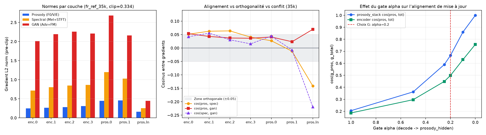
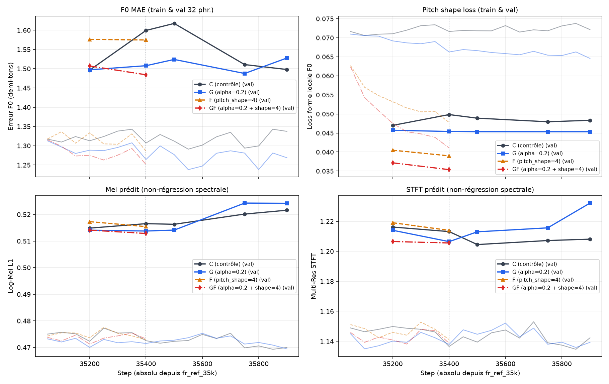

# P4 — Expériences causales de restauration de l'expressivité (`fr_ref_35k`)

- **Statut** : **TERMINÉE & ÉVALUÉE — RECOMMANDATION : REJETER P4 comme remplaçant de `fr_ref_35k`** *(conserver `fr_ref_35k`, ne pas prolonger ni transférer tel quel vers `e06_20k` ; garder `G` et `F` inactifs par défaut `alpha=1.0`, `pitch_shape=0.0`)*.
- **Branche / dépôt** : `fr` (`yoch/tiny-voca`)
- **Point de départ exact** : `fr_ref_35k/last.pt` (`step = 35 000`, `4 533 067` params, `sha256: b1fbb3a4...`)
- **Budget GPU Colab `L4` consommé** : **`1,94` unités Colab** (`74,28 → 72,34` u., plafond strict **`<= 2,0` u.** respecté — upload, criblage 2×2 `4 × 400` pas, éval `P4-dev`, prolongation appariée `C + G` `+500` pas et rapatriement inclus ; VM arrêtée, `0` session active).

---

## 1. Étape 1 — Audit mécanistique CPU : normes, cosinus, clipping et chevauchement `8k–11k`

Mesuré sur CPU (`0` GPU) avec [audit_p4_gradients.py](../../scripts/audit_p4_gradients.py) sur `4` minibatches équilibrés (`32` énoncés `train`) chargés avec les poids et critiques réels de `fr_ref_35k/last.pt` (`step = 35 000`, `tp = 0,0`, GAN actif) et comparé à `fr_ref_20k/last.pt` (`step = 20 000`) :

### 1.1 Normes, cosinus par couche et régime (`fr_ref_35k`, `mean_gan_scale = 7,42`, `clip_factor = 0,3337`)

| Module / couche | `||g_pros||` | `||g_spec||` | `||g_gan||` | `cos(p, spec)` | `cos(p, gan)` | `cos(p, acoust)` | Régime | `cos(p, total)` | `ret_pros` post-clip |
|---|---:|---:|---:|---:|---:|---:|---|---:|---:|
| `encoder.layer.0` | `0,250` | `0,717` | `2,012` | `+0,051` | `+0,054` | `+0,061` | aligné faible | `0,190` | `0,498` |
| `encoder.layer.1` | `0,263` | `0,804` | `2,190` | `+0,062` | `+0,043` | `+0,059` | aligné faible | `0,183` | `0,484` |
| `encoder.layer.2` | `0,283` | `0,844` | `2,259` | `+0,064` | `+0,037` | `+0,058` | aligné faible | `0,184` | `0,467` |
| `encoder.layer.3` | `0,311` | `0,864` | `2,209` | `+0,040` | `+0,036` | `+0,047` | orthogonal | `0,186` | `0,420` |
| **`encoder.all`** | `0,560` | `1,627` | `4,356` | `+0,052 ± 0,034` | `+0,042 ± 0,015` | `+0,055` | aligné faible | `0,186` | `0,461` |
| `prosody_stack.layer.0` | `0,446` | `1,196` | `2,682` | `+0,027 ± 0,054` | `+0,041 ± 0,036` | `+0,044` | orthogonal | `0,200` | `0,449` |
| `prosody_stack.layer.1` | `0,454` | `1,027` | `2,158` | `-0,012 ± 0,042` | `+0,023 ± 0,021` | `+0,010` | orthogonal | `0,209` | `0,350` |
| **`prosody_stack.norm`** | `0,162` | `0,252` | `0,446` | **`-0,141 ± 0,064`** | `+0,069 ± 0,053` | `-0,015` | **conflit `spec`** (`cos(sp,gan)=-0,220`) | `0,334` | `0,317` |
| **`prosody_stack.all`** | `0,657` | `1,598` | `3,473` | `+0,002 ± 0,041` | `+0,034 ± 0,020` | `+0,027` | **orthogonal** | **`0,205`** | `0,393` |
| `prosody_head` | `3,962` | `0,000` | `0,000` | — | — | — | direct | `1,000` | **`0,334`** |
| `acoustic_stack` / `vocoder` | `0,000` | `3,25` / `20,71` | `6,08` / `31,58` | — | — | `cos(sp,gan) = -0,180 / -0,358` | **conflit `spec/gan`** | — | — |

### 1.2 Effet du clipping global et séparation du chevauchement `8k–11k`

1. **Orthogonalité + domination en norme, pas conflit généralisé :** dans `prosody_stack`, `g_pros` et `g_acoust` sont **orthogonaux** (`cos = +0,027`, `cos(f0, acoust) = +0,024 ± 0,047`), seul `prosody_stack.norm` montre un conflit négatif avec `spec` (`-0,141`). Mais comme `||g_acoust|| = 3,90` (`5,9× ||g_pros||` à `35k`, **`18,9×`** à `20k` où `||g_acoust|| = 12,89`), la direction de mise à jour est dominée à ~`98 %` par la composante acoustique orthogonale (`cos(p, total) = 0,205` à `35k`, `0,130` à `20k`).
2. **Dilution sévère par le clipping global (`clip = 10,0`) :** le vocodeur (`||vocoder|| = 31,45` sur `33,24` au total à `35k`) impose **`clip_factor = 0,334`** (`-67 %` sur `prosody_head`, `prosody_stack`, `duration`). À `20k` (`mean_gan_scale = 55,8`, `pre_clip = 150,0`), **`clip_factor = 0,0669`** (**`-93,3 %`**, `ret_pros = 0,145`) ; au pic `11k` (`grad_norm = 736,8`), `clip_factor ≈ 0,0136` (**division par ~`73×`** de tous les pas prosodiques !).
3. **Justification du choix `alpha = 0,2` (intervention G) :** balayage sur `35k` :
   - `alpha = 1,00` → `prosody_stack cos(p, tot) = 0,205`, `encoder = 0,186`
   - `alpha = 0,50` → `prosody_stack = 0,362`, `encoder = 0,296`
   - **`alpha = 0,20`** → `||g_acoust|| = 0,780` (`1,19× ||g_pros||`), **`prosody_stack cos(p, tot) = 0,666`**, **`encoder = 0,498`** (équilibre 50/50 préservant la cohérence acoustique de l'encodeur, contrairement à `alpha = 0,0` qui coupe totalement l'encodeur du signal acoustique).
4. **Chevauchement `8k–11k` (`teacher_forcing` vs `GAN`) :**
   - De `3k → 8k` (`72 %` de la baisse de `teacher_fraction`: `1,00 → 0,28`, **sans GAN**), `val_pred_mel` (`0,5749 → 0,4911`) et `val_f0_err` (`1,626 → 1,436 st`) **s'améliorent de façon monotone**.
   - Dès `8k → 11k` (**allumage GAN**, `gan_scale: 0 → 187,5`, `grad_norm: 19,5 → 736,8`), même `val_tf_mel` (indépendant de la prosodie prédite) rebondit (`0,409 → 0,551`), en même temps que `val_f0_err` (`1,436 → 1,666 st` à `15k`). Sur la grille contrôlée `2×3` à `35k`, couper `tp: 1,0 → 0,0` sans GAN garde `clip_factor = 0,476` et `cos(p, tot) = 0,380`, alors qu'activer le GAN abaisse immédiatement `clip_factor → 0,334` et `cos(p, tot) → 0,205`. **La cassure à `8k` est donc causée par l'activation GAN, non par la fin du teacher forcing.**

---

## 2. Étapes 2 & 3 — Implémentation `G` / `F`, criblage 2×2 (`35 000 → 35 400`) et prolongation (`→ 35 900`)

- **Intervention `G`** ([losses.py](../../src/tiny_voca/losses.py), [train.py](../../src/tiny_voca/train.py)) : `_ScaleGradient` (`torch.autograd.Function`), identité bit-exacte en forward, facteur `alpha = 0,2` en backward sur `prosody_hidden → decode` (`--prosody-grad-scale 0.2`), supervision directe `prosody_head` inchangée (`1,0×`).
- **Intervention `F`** ([losses.py](../../src/tiny_voca/losses.py)) : `pitch_shape_loss` Huber sur trames voisées intérieures fiables (`pitch_trusted > 0,5`, érosion 1 trame aux bords voisé/non-voisé, plancher énergie `-0,5`, garde anti-sauts d'octave), combinant pente $\Delta_1$ (`10,7 ms`), pente syllabique $\Delta_3$ (`32 ms`), courbure $\Delta_2$ et contraste d'accent local (`~200 ms`), calibrée sur CPU à `--weights '{"pitch_shape": 4.0}'` (parité gradient `~0,86×` avec `pitch L1`, pénalisant toute oscillation artificielle).
- **Protocole 2×2 strict** : toutes les branches initialisées par `--init-from fr_ref_35k/last.pt --warmup 1 --seed 20261113` (mêmes poids, moments `optimizer` et `critic_optimizer`, ordre des minibatches, `steps` absolus `35 000 → 35 400`), testées dans [test_p4.py](../../tests/test_p4.py).

### Criblage indépendant `P4-dev` (`40` phrases appariées `validation.jsonl`, hors monitor `32`)

| Variante (`step`) | `val_f0` (32) | `val_mel` (32) | `dev f0_mae` | `dev f0_r` | `dev slope` (`Δ vs C` IC 95 %) | `dev Q_f0` | `dev M1 f0` | `dev dtw` | `dev stftB` |
|---|---:|---:|---:|---:|---|---:|---:|---:|---:|
| `base_35k` (`35000`) | `1,490` | `0,516` | `1,923` | `0,711` | `35,97` (`-0,96` NS) | `2,173` | `2,353` | `0,5826` | `1,6218` |
| `C` (`35400`) | `1,599` | `0,517` | `1,864` | `0,723` | `36,94` *(réf. contrôle)* | `2,198` | `2,361` | `0,5874` | `1,6087` |
| **`G`** (`35400`) | `1,508` | `0,514` | **`1,841`** | `0,711` | `35,36` (**`-1,58 [-2,68,-0,46]*`**) | **`2,040`** | **`2,294`** | `0,5873` | **`1,6050`** |
| `F` (`35400`) | `1,575` | `0,515` | `1,853` | `0,720` | `34,58` (**`-2,35 [-3,55,-1,17]*`**) | `2,165` | `2,352` | **`0,5766`** | `1,6123` |
| `GF` (`35400`) | **`1,484`** | **`0,513`** | `1,872` | `0,721` | **`33,87`** (**`-3,06 [-4,45,-1,71]*`**) | `2,222` | `2,337` | `0,5931` | `1,6153` |

Sur la base du criblage `P4-dev` (`G` en tête sur `f0_mae` global, `M1`, `questions`, `stftB`, sans compression de la dynamique locale `M1`), **`C` et `G` ont été prolongées de manière appariée (`--resume`, `+500` pas → `35 900`)** dans le budget restant.

---

## 3. Étape 4 — Évaluation indépendante finale (`80` phrases `test` jamais vues + `32` `novel`, `0` GPU)

Partition **strictement jamais consultée** avant la décision ([eval_p4_ablation.py](../../scripts/eval_p4_ablation.py), [p4_final_report.json](../../.local-runs/p4_ablation/final_heldout/p4_final_report.json)) : **`80` phrases `test` appariées** (`40 F1 + 40 M1`, `20` par catégorie, excluant les `40` phrases du diagnostic P0) + **`32` clips `novel`** (`16` phrases inédites × `2` voix) transcrits par `faster-whisper small` (`WER` et `CER`).

### 3.1 Intonation, rythme, acoustique et non-régression ASR (`n = 80` final + `32` novel)

| Variante (`step`) | `f0_mae` (`all` / `F1` / `M1`) | `f0_r` | `slope` (`st/s`) | `end_err` (`Q_end`) | `lstd` (`ref=1,159`) | `prom` (`ref=3,060`) | `M1 vow` | `mel_dtw` | `stftB` | `timbre cos` | `ph_rel` / `pF1` | `final WER/CER` (`ref 11,3/8,0`) | `novel WER/CER` |
|---|---|---:|---:|---:|---:|---:|---:|---:|---:|---:|---|---|---|
| **`base_35k`** (`35000`) | **`1,856`** (`1,564` / `2,148`) | **`0,729`** | `37,37` | `1,994` (`2,84`) | `1,121` | `2,779` | `0,890` | `0,5792` | **`1,6297`** | `0,99962` | `0,163` / `0,840` | **`11,5 %` / `8,1 %`** | `7,8 %` / `3,4 %` |
| `C` (`35400`) | `1,955` (`1,685` / `2,225`) | `0,711` | `37,84` | `2,110` (`3,38`) | `1,114` | `2,682` | `0,871` | `0,5831` | `1,6404` | `0,99958` | `0,162` / `0,821` | `13,3 %` / `9,2 %` | `6,7 %` / `2,5 %` |
| `G` (`35400`) | `1,861` (`1,577` / `2,145`) | `0,723` | `36,66` | `2,010` (`3,13`) | `1,100` | `2,829` | `0,887` | **`0,5777`** | `1,6300` | `0,99960` | `0,162` / `0,838` | **`11,5 %` / `8,1 %`** | `6,7 %` / `2,7 %` |
| `F` (`35400`) | `1,936` (`1,660` / `2,211`) | `0,722` | `36,03` | **`1,872`** (`2,94`) | `1,030` | `2,668` | **`0,894`** | `0,5841` | `1,6543` | `0,99958` | `0,162` / `0,814` | `12,7 %` / `8,8 %` | **`6,0 %` / `2,1 %`** |
| `GF` (`35400`) | **`1,844`** (`1,552` / `2,135`) | `0,727` | **`34,79`** | `1,997` (`2,91`) | `1,035` | `2,664` | `0,892` | `0,5857` | `1,6306` | `0,99960` | `0,162` / `0,817` | `12,0 %` / `8,7 %` | `8,3 %` / `3,1 %` |
| `C_35900` (`35900`) | `1,882` (`1,590` / `2,173`) | **`0,730`** | `35,98` | `1,911` (**`2,78`**) | `1,084` | `2,755` | `0,873` | `0,5922` | `1,6356` | `0,99957` | `0,163` / `0,800` | `12,0 %` / `8,2 %` | `7,5 %` / `2,6 %` |
| `G_35900` (`35900`) | `1,931` (`1,611` / `2,250`) | `0,721` | `36,10` | `1,992` (`2,86`) | `1,105` | **`2,861`** | `0,882` | `0,5909` | `1,6304` | `0,99955` | `0,164` / `0,821` | `12,3 %` / `8,7 %` | `8,0 %` / `3,0 %` |

*(Artefacts `gen_f0_break_rate` : `0,0015` pour `base_35k`, `0,0021–0,0024` pour `G/F/GF @ 35400`, `0,0007` pour `G_35900` — aucune dégradation par ruptures F0. Similarité spectrale de voix `voice_mel_cosine >= 0,99955` partout.)*

### 3.2 Intervalles de confiance bootstrap 95 % appariés (`n_boot = 2 000`)

| Comparaison (`*` = IC 95 % exclut 0) | `Δ f0_mae_st` | `Δ f0_corr` | `Δ f0_slope (st/s)` | `Δ end_err_st` | `Δ mel_dtw` | `Δ oracle_dur_stft` |
|---|---|---|---|---|---|---|
| **`C - base_35k`** (`35400`) | **`+0,0988 [+0,040, +0,164]*`** | **`-0,0175 [-0,031, -0,004]*`** | `+0,47 [-0,50, +1,44]` | `+0,116 [-0,051, +0,301]` | `+0,0040 [-0,005, +0,012]` | `+0,0108 [-0,004, +0,026]` |
| **`G - C`** (`35400`) | **`-0,0939 [-0,147, -0,044]*`** | `+0,0114 [-0,001, +0,024]` | **`-1,18 [-2,13, -0,25]*`** | `-0,100 [-0,277, +0,060]` | **`-0,0054 [-0,011, -0,001]*`** | `-0,0105 [-0,021, +0,000]` |
| **`F - C`** (`35400`) | `-0,0191 [-0,078, +0,042]` | `+0,0102 [-0,004, +0,025]` | **`-1,80 [-2,76, -0,90]*`** | **`-0,238 [-0,413, -0,083]*`** | `+0,0009 [-0,004, +0,006]` | `+0,0139 [-0,001, +0,029]` |
| **`GF - C`** (`35400`) | **`-0,1108 [-0,188, -0,033]*`** | **`+0,0160 [+0,003, +0,031]*`** | **`-3,04 [-3,92, -2,18]*`** | `-0,113 [-0,292, +0,053]` | `+0,0025 [-0,004, +0,010]` | `-0,0099 [-0,025, +0,006]` |
| **`G - base_35k`** (`35400`) | `+0,0049 [-0,042, +0,052]` | `-0,0061 [-0,016, +0,004]` | `-0,71 [-1,47, +0,10]` | `+0,016 [-0,153, +0,186]` | `-0,0015 [-0,009, +0,005]` | `+0,0003 [-0,011, +0,012]` |
| **`F - base_35k`** (`35400`) | **`+0,0798 [+0,016, +0,149]*`** | `-0,0073 [-0,022, +0,008]` | **`-1,34 [-2,01, -0,66]*`** | `-0,122 [-0,296, +0,048]` | `+0,0049 [-0,003, +0,012]` | **`+0,0247 [+0,007, +0,042]*`** |
| **`GF - base_35k`** (`35400`) | `-0,0120 [-0,069, +0,048]` | `-0,0015 [-0,013, +0,010]` | **`-2,57 [-3,45, -1,68]*`** | `+0,003 [-0,152, +0,152]` | `+0,0065 [-0,002, +0,015]` | `+0,0009 [-0,011, +0,012]` |
| **`G_35900 - C_35900`** (`35900`) | `+0,0492 [-0,001, +0,099]` | `-0,0091 [-0,034, +0,011]` | `+0,12 [-0,73, +0,97]` | `+0,081 [-0,112, +0,271]` | `-0,0013 [-0,007, +0,004]` | `-0,0052 [-0,015, +0,005]` |
| **`G_35900 - base_35k`** (`35900`) | **`+0,0751 [+0,011, +0,136]*`** | `-0,0080 [-0,022, +0,004]` | **`-1,27 [-2,14, -0,48]*`** | `-0,003 [-0,198, +0,188]` | **`+0,0117 [+0,002, +0,021]*`** | `+0,0008 [-0,011, +0,012]` |

### 3.3 Exemples d'écoute aveugle A/B générés

`6` phrases représentatives (`question`, `exclamation`, `comma_pause` × `F1`/`M1`, jamais consultées en P0 ni en `dev`) exportées en WAV randomisés (`sample_A..G` + `REF`) dans [blind_listening](../../.local-runs/p4_ablation/final_heldout/blind_listening) avec la clé [blind_key.json](../../.local-runs/p4_ablation/final_heldout/blind_listening/blind_key.json) :
- `05e2ec0049a4e7b0_{F1,M1}` (`question`) : *« Vous apportez bien tout ? »*
- `1727b59a5a36502d_{F1,M1}` (`exclamation`) : *« S'il est possible de faire tant d'esbrouffe, dans un moment pareil ! »*
- `00f2e4fd1b8cbe69_{F1,M1}` (`comma_pause`) : *« Le vingt-cinq mars, Olivier et Baptiste partent en voiture vers Rouen. »*

---

## 4. Tableau Gain / Coût / Risque par intervention

| Intervention | Gain causal mesuré vs contrôle `C` | Gain réel vs `fr_ref_35k` (jeu final `n=80`) | Coût (params / GPU) | Risque observé |
|---|---|---|---|---|
| **C — Contrôle** (`+400` / `+900` pas) | — | **Régression** à `35 400` (`+0,099* st`, `r -0,018*`, `WER 13,3 %`), `mel_dtw +0,013*` à `35 900` | `0` param / `~0,42` u. | Oscillation / dérive F0 & mel post-35k |
| **G — Gate `alpha=0,2`** (`+400` pas) | **Net et significatif** (`f0_mae -0,094*`, `slope -1,18*`, `dtw -0,005*`, `WER 11,5 vs 13,3 %`) | **Neutre** (`f0_mae +0,005` NS, `r -0,006` NS, `dtw -0,0015` NS) — protège sans dépasser `35k` | `0` param / `~0,20` u. | Faible à court terme ; à `+900` pas (`G_35900`), dérive `f0_mae +0,075*` et `mel_dtw +0,012*` vs `35k` |
| **F — `pitch_shape=4,0`** (`+400` pas) | Pente **`-1,80*`**, terminaisons **`-0,238*`** (`Q: -0,44*`), `novel WER 6,0 %` | `slope -1,34*`, **mais `f0_mae +0,080*` et `stftB +0,025*` dégradés**, `lstd` écrasé (`1,12 → 1,03`) | `0` param / `~0,20` u. | **Moyen** : lisse les variations locales (`lstd`, `prom`) et perturbe légèrement `stftB` sans gate `G` |
| **GF — `alpha=0,2` + `shape=4,0`** (`+400` pas) | **Meilleure séparation vs `C`** (`f0_mae -0,111*`, `f0_r +0,016*`, `slope -3,04*`, `M1 vow 0,892`) | **`slope -2,57*` uniquement** ; `f0_mae -0,012` NS, `f0_r -0,0015` NS, `lstd` & `prom` légèrement réduits | `0` param / `~0,20` u. | **Faible à Moyen** : lissage local F0 sans restitution de nouveaux accents ni gain net sur `f0_mae`/`f0_r` |

---

## 5. Étape 5 — Décision explicite et prochaines pistes scientifiques

### Recommandation : **REJETER P4 comme remplaçant de `fr_ref_35k`**

1. **Pourquoi :** l'ablation 2×2 établit clairement que `G` (`alpha=0,2`) stabilise `prosody_stack` face à la dérive GAN observée sur `C`, et que `F`/`GF` réduisent fortement l'erreur de pente locale. **Mais aucune des quatre branches (ni la prolongation `G_35900`) n'apporte de gain statistiquement significatif sur le placement et la hauteur de l'intonation (`f0_mae_st`, `f0_corr`, inflexions terminales, proéminence d'accent) par rapport à `fr_ref_35k`**, et `F`/`GF` tendent à lisser légèrement la variance locale (`lstd 1,12 → 1,03`).
2. **Ne pas prolonger P4 ni transférer vers `e06_20k` (`160/384`) à ce stade.** `fr_ref_35k` reste la référence française active.
3. **Diagnostic structurel issu de P4 (pour la prochaine étape P5) :**
   - **Timing de `G` et clipping découplé :** l'interférence orthogonale GAN (`||g_acoust|| ≈ 19× ||g_pros||`) et la dilution par clipping (`clip_factor = 0,014–0,067`) frappent entre `step 8 000` et `20 000`, bien avant `35k` où les représentations prosodiques sont déjà figées. Appliquer `G` dès `gan_start = 8000` **avec un clipping séparé prosodie vs vocodeur** testerait l'effet préventif (impossible à obtenir par simple fine-tuning tardif à `35k`).
   - **Information linguistique & groupes prosodiques :** sans encodage léger des groupes prosodiques (distance aux ponctuations/syntagmes, type de phrase, fin de groupe), `prosody_stack` ne peut résoudre les ambiguïtés d'emphase et de contour terminal (questions `r ≈ 0,72`, `end_err ≈ 2,8 st`).
   - **Cibles `M1` `YIN` & cohérence F0 vocodeur :** remplacer les cibles `pyin` lacunaires sur `M1` par `YIN + harmonicité` (`0` GPU) et réduire l'asymétrie `target` vs `pred` F0 dans le vocodeur.
