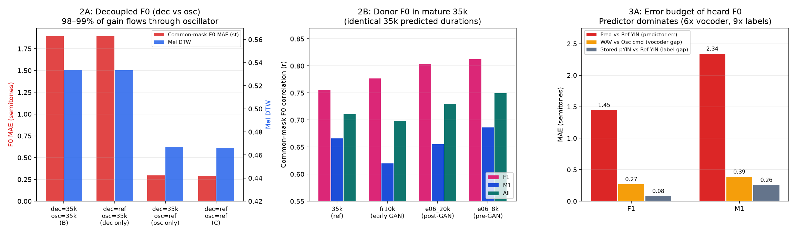
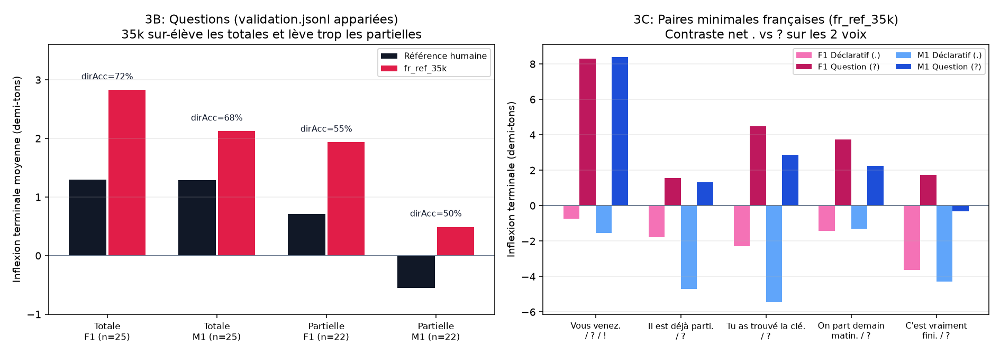
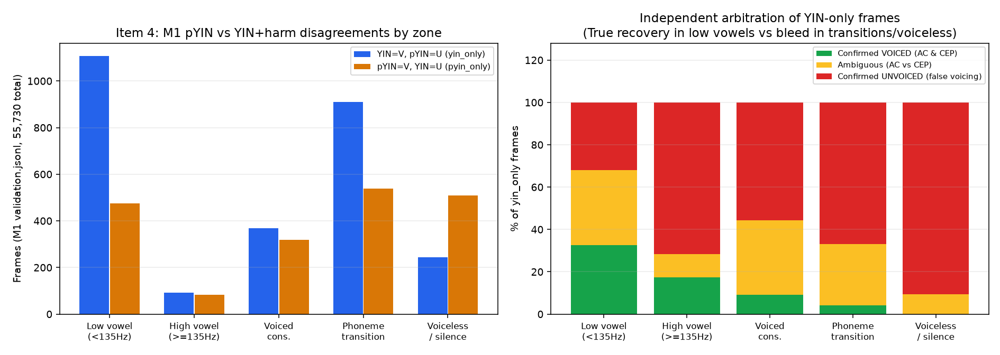
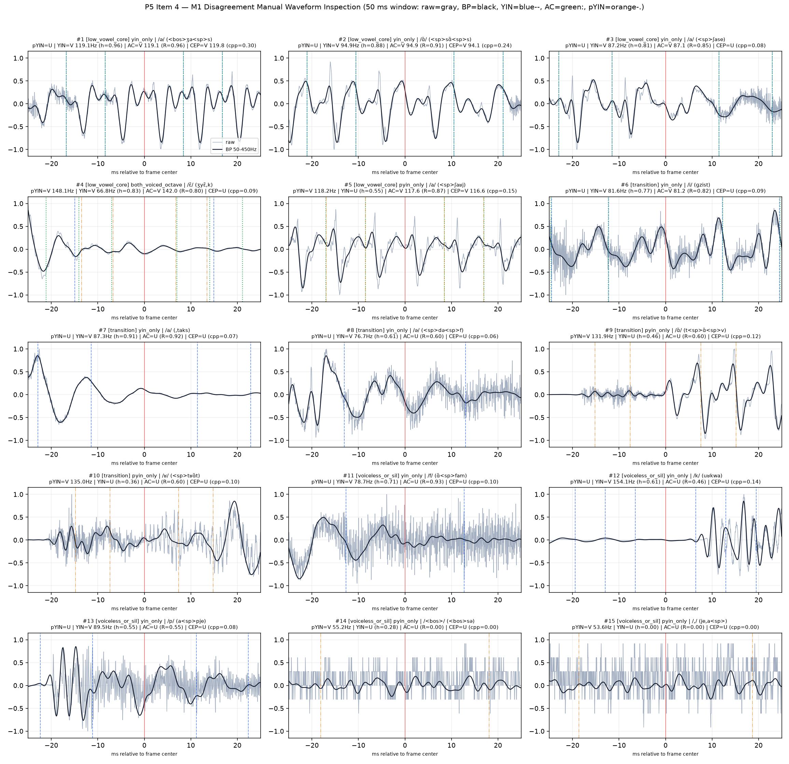

# P5 — Reproductibilité P4, expériences causales F0 à poids figés, audit M1 et plan GPU chiffré

- **Statut** : **TERMINÉ (100 % CPU, `0,00` unité GPU Colab consommée)**
- **Branche / dépôt** : `fr` (`yoch/tiny-voca`) — HEAD de référence revalidé avant travaux : `33940991194b91cf2632d206d8039ec0e72ee45c`
- **Référence active conservée** : `fr_ref_35k` (`192/640`, `4 533 067` params, `sha256: c2bb29b93689ce6f413e373c8ffedc22c0607c4d562280e9f914be58b39c9876`)
- **Réglages par défaut inchangés** : `--prosody-grad-scale 1.0`, `pitch_shape = 0.0` (G et F inactifs par défaut)
- **Solde Colab vérifié** : `72,34` unités (`0,00/h`, `0` session active — aucun VM provisionné)
- **Jeu `P4-final` (`80` enregistrements / `40` textes)** : **désormais classé comme déjà consulté** ; **`121` paires `test.jsonl` strictement vierges (`242` enregistrements)** gelées dans [p5_untouched_test_reserve.json](p5_untouched_test_reserve.json).

---

## 1. Verdict P4 rendu 100 % reproductible

### 1.1 Empreintes SHA-256 complètes des checkpoints

Toutes les empreintes sont vérifiées et consignées dans [p5_p4_reproducibility_manifest.json](p5_p4_reproducibility_manifest.json) :

| Checkpoint | Fichier local | Taille (octets) | SHA-256 complet |
|---|---|---:|---|
| `base_35k_inference` | `.local-runs/colab/fr_ref_35k/fr_ref_35k_final/inference.pt` | `18 193 413` | `c2bb29b93689ce6f413e373c8ffedc22c0607c4d562280e9f914be58b39c9876` |
| `base_35k_last` | `.local-runs/colab/fr_ref_35k/fr_ref_35k_final/last.pt` | `87 092 264` | `b1fbb3a41c98461eab6635598dab004a49c494a3e209809e09a8c06246e99ad4` |
| `C_35400` | `.local-runs/p4_ablation/p4_final/C/inference_35400.pt` | `18 193 413` | `d98d296be44bbe0b3102500f6527d857cae0debe9ce1115a069acfbc2408e4ec` |
| `G_35400` | `.local-runs/p4_ablation/p4_final/G/inference_35400.pt` | `18 193 413` | `76e9c3f1ca3cae55f479373965fcdc15c46bb4883326e182bcd295a28663799f` |
| `F_35400` | `.local-runs/p4_ablation/p4_final/F/inference_35400.pt` | `18 193 413` | `54e2dc1163cb69d9bd785687e8ffe773f6800af148ad0ff0cd02af22feeea6d0` |
| `GF_35400` | `.local-runs/p4_ablation/p4_final/GF/inference_35400.pt` | `18 193 413` | `671ea99194b91a257c67d4e0c71a3b56a3a2af4028bcc50443049cf9163eac15` |
| `C_35900` | `.local-runs/p4_ablation/p4_final/C/inference_35900.pt` | `18 193 413` | `bf84ebc4f7b1e551d9fca4a39d67f401189802fe39af9a289e7c1292003df643` |
| `G_35900` | `.local-runs/p4_ablation/p4_final/G/inference_35900.pt` | `18 193 413` | `db47880785a1541e32af0938e805202bf731dfa6eef0b71aeb039be71a524229` |
| `e06_8k` *(pré-GAN)* | `.local-runs/colab/e06_20k/e06_20k_final/step-00008000.pt` | `43 051 177` | `8308f2d90c657bfe5b458805f2fdd08f531375a37c3490160d1578405b1eefc1` |
| `e06_20k_inference` | `.local-runs/colab/e06_20k/e06_20k_final/inference.pt` | `10 692 677` | `5dd8b9c88fc2e3dfe2244245392dbedb26f2b7a74311bff10b7d4268f630851c` |
| `fr_ref_10k` *(GAN précoce)* | `.local-runs/colab/fr_ref_20k_snap10k/snap10k/step-00010000.pt` | `87 099 973` | `55691de72e754cb49212bc9be2838bda25c4b6365a6a65a2666cd4b53b21a6ac` |

> **Provenance explicite** : aucun `step-00008000.pt` pour `fr_ref` (`192/640`) n'existe localement (seuls `10k`, `15k`, `20k`, `35k` ont été rapatriés). Le seul checkpoint pré-GAN `8k` disponible localement est `e06_20k/step-00008000.pt` (`160/384`), qui est donc toujours confronté à son témoin de même largeur post-GAN `e06_20k/inference.pt` ainsi qu'à `fr_ref_10k` et `fr_ref_35k`.

### 1.2 Intersections inter-splits, garde-fou d'exclusion et réserve vierge

- **Zéro fuite** entre `train` (`6 672` id / `3 421` textes), `monitor_32` (`32` id / `18` textes), `p4_dev` (`40` id / `20` textes), `p0_40` (`40` id / `20` textes) et `p4_final_consulted` (`80` id / `40` textes) : **toutes les intersections deux à deux valent `0`** (en `id` comme en `text_hash`).
- Seuls les rapports automatiques `evaluate.py` (`e06_eval` / `fr35k_eval`, `24` clips identiques issus de `train` + `test`) partagent `8` textes avec `train` (leur bloc train), `1` texte avec `p0_40` (`496dff3d80fefa59_M1`) et `4` textes avec `p4_final_consulted` (`0232fe12cf33fe58_F1`, `13c83936caebe2b5_M1`, `2971efc4d35ceb77_M1`, `5ac82ac04693b361_F1`). Tous ces textes sont exclus de la réserve vierge.
- **Garde-fou bloquant ajouté** dans [eval_p4_ablation.py](../../scripts/eval_p4_ablation.py) (`load_exclusion_sets`) : l'évaluation `--partition final` **échoue explicitement** (`FileNotFoundError` / `ValueError`) si un manifeste d'exclusion requis manque ou est vide (couvert par [test_p5.py](../../tests/test_p5.py)).
- **Mesures par enregistrement (`480` lignes = `6` variantes × `80` enregistrements)** publiées dans [p5_p4_final_per_recording.csv](p5_p4_final_per_recording.csv), et tous les `text_hash` sélectionnés dans [p5_p4_reproducibility_manifest.json](p5_p4_reproducibility_manifest.json).
- **Réserve strictement vierge (`test.jsonl`)** gelée dans [p5_untouched_test_reserve.json](p5_untouched_test_reserve.json) : **`121` paires `F1/M1` (`242` enregistrements)** : `64` `plain_assert`, `27` `question`, `23` `comma_pause`, `7` `exclamation` — **jamais touchées en P5**.

### 1.3 Bootstrap apparié au niveau du texte, stratifié par catégorie (`F1/M1` groupés par texte, `n_boot = 5 000`)

| Contraste (`P4-final`, `40` textes / `80` enregistrements) | `f0_mae_st` | `f0_corr` | `f0_slope_mae` | `end_delta_err` | `mel_dtw` | `oracle_dur_stft` |
|---|---|---|---|---|---|---|
| **`G − C` @35 400** | **`-0,0939` `[-0,1411, -0,0449]`\*** | `+0,0114` `[-0,0003, +0,0229]` | **`-1,1796` `[-1,9648, -0,4474]`\*** | `-0,0999` `[-0,2632, +0,0490]` | **`-0,0054` `[-0,0102, -0,0013]`\*** | `-0,0105` `[-0,0209, +0,0005]` |
| **`F − C` @35 400** | `-0,0191` `[-0,0845, +0,0453]` | `+0,0102` `[-0,0034, +0,0239]` | **`-1,8030` `[-2,6021, -1,0064]`\*** | **`-0,2383` `[-0,3729, -0,1104]`\*** | `+0,0009` `[-0,0032, +0,0052]` | `+0,0139` `[-0,0035, +0,0305]` |
| **`GF − C` @35 400** | **`-0,1108` `[-0,1928, -0,0298]`\*** | **`+0,0160` `[+0,0040, +0,0285]`\*** | **`-3,0403` `[-3,8175, -2,2163]`\*** | `-0,1134` `[-0,2970, +0,0338]` | `+0,0025` `[-0,0042, +0,0105]` | `-0,0099` `[-0,0269, +0,0067]` |
| **Interaction `GF − G − F + C`** | `+0,0022` `[-0,0621, +0,0681]` *(additif)* | `-0,0056` `[-0,0182, +0,0076]` | `-0,0577` `[-1,1530, +1,1092]` *(additif)* | **`+0,2247` `[+0,0125, +0,4532]`\*** *(antagoniste)* | **`+0,0070` `[+0,0015, +0,0134]`\*** *(antagoniste)* | `-0,0133` `[-0,0279, +0,0017]` |
| **Effet principal `G` (2×2)** | **`-0,0928` `[-0,1374, -0,0481]`\*** | `+0,0086` `[-0,0012, +0,0170]` | **`-1,2084` `[-1,7126, -0,6707]`\*** | `+0,0125` `[-0,1045, +0,1132]` | `-0,0019` `[-0,0055, +0,0016]` | **`-0,0171` `[-0,0268, -0,0080]`\*** |
| **Effet principal `F` (2×2)** | `-0,0180` `[-0,0737, +0,0351]` | `+0,0074` `[-0,0019, +0,0173]` | **`-1,8318` `[-2,3978, -1,2431]`\*** | **`-0,1259` `[-0,2152, -0,0399]`\*** | **`+0,0045` `[+0,0003, +0,0096]`\*** | `+0,0072` `[-0,0048, +0,0189]` |
| `C − base_35k` @35 400 | **`+0,0988` `[+0,0425, +0,1528]`\*** | **`-0,0175` `[-0,0308, -0,0035]`\*** | `+0,4665` `[-0,3453, +1,2644]` | `+0,1160` `[-0,0615, +0,2989]` | `+0,0040` `[-0,0034, +0,0110]` | `+0,0108` `[-0,0014, +0,0235]` |
| `G − base_35k` @35 400 | `+0,0049` `[-0,0415, +0,0532]` *(NS)* | `-0,0061` `[-0,0181, +0,0049]` | **`-0,7131` `[-1,4380, -0,0272]`\*** | `+0,0161` `[-0,1538, +0,1756]` | `-0,0015` `[-0,0078, +0,0042]` | `+0,0003` `[-0,0100, +0,0104]` |
| **`G_35900 − C_35900`** | `+0,0492` `[-0,0001, +0,1006]` *(inversé, NS)* | `-0,0091` `[-0,0355, +0,0110]` | `+0,1197` `[-0,4770, +0,7550]` | `+0,0808` `[-0,0980, +0,2718]` | `-0,0013` `[-0,0054, +0,0022]` | `-0,0052` `[-0,0143, +0,0042]` |
| `G_35900 − base_35k` | **`+0,0751` `[+0,0142, +0,1363]`\*** | `-0,0080` `[-0,0211, +0,0040]` | **`-1,2686` `[-1,9381, -0,6428]`\*** | `-0,0026` `[-0,1877, +0,1825]` | **`+0,0117` `[+0,0036, +0,0205]`\*** | `+0,0008` `[-0,0096, +0,0112]` |

**Conclusion statistique consolidée (P4)** : à `35 400`, `G` empêche surtout la dérive initiale de `C` par rapport à `base_35k` (`C` se dégrade de `+0,0988 st`*, `G` reste à `+0,0049 st` NS) ; `F` réduit la pente (`-1,83 st/s`*) et l'erreur terminale (`-0,126 st`*) au prix d'un léger coût spectral (`mel_dtw +0,0045`*), sans synergie avec `G` (interaction antagoniste sur `end_err +0,225*` et `mel_dtw +0,0070*`). À `35 900`, l'avantage de `G` sur `C` disparaît (`+0,0492 st` NS), et `G_35900` reste significativement inférieur à `base_35k` (`+0,0751 st`*, `mel_dtw +0,0117`*).

**Commandes de reproduction directe :**

```bash
# Audit complet P4 (hashes, intersections, CSV par enregistrement, bootstrap stratifié texte, réserve vierge)
PYTHONPATH=src:scripts ./env/bin/python scripts/reproduce_p4_verdict.py

# Reproduire le contraste G_35900 - C_35900 en une commande (échoue si manifeste d'exclusion absent)
PYTHONPATH=src:scripts ./env/bin/python scripts/eval_p4_ablation.py \
  --partition final --per-category-pairs 10 --seed 20261119 \
  --p0-report .local-runs/p0_expressivity/p0_report.json \
  --variant C_35900=.local-runs/p4_ablation/p4_final/C/inference_35900.pt \
  --variant G_35900=.local-runs/p4_ablation/p4_final/G/inference_35900.pt \
  --compare G_35900:C_35900 \
  --out-dir .local-runs/p5_audit/repro_35900
```

---

## 2. Expérience causale prioritaire à poids figés (`P4-dev`, `40` énoncés / `20` textes)

Exécutée via [eval_p5_f0_causal.py](../../scripts/eval_p5_f0_causal.py) en figeant le décodeur, le vocodeur, le bruit (`seed` identique par énoncé), l'énergie et le voisement de `fr_ref_35k`, tout en faisant varier indépendamment la F0 fournie au décodeur (`F0_dec`) et à l'oscillateur (`F0_osc`).

**Vérification d'identité bit-exacte avec P0** : `max|M00 − B_oracle_dur| = 0,0` et `max|M11 − C_oracle_dur_f0| = 0,0`.



### 2.1 Matrice 2×2 `(F0_dec × F0_osc) ∈ {35k, ref}` (durées oracle)

| Condition | `mel_dtw` | `stft_loss` | `cm_f0_mae_st` | `cm_f0_corr` | `slope_mae` | Part du gain total (`M11 − M00`) |
|---|---:|---:|---:|---:|---:|---|
| `M00` (`dec=35k, osc=35k` = P0 `B`) | `0,5337` | `1,6218` | `1,8913` | `0,7293` | `34,61` | témoin |
| `M10` (`dec=ref, osc=35k`) | `0,5335` (`-0,0002`, NS) | `1,6219` (`+0,0001`, NS) | `1,8936` (`+0,0022`, NS) | `0,7284` (`-0,0009`, NS) | `34,23` | **`~0,3 %`** *(effet nul)* |
| `M01` (`dec=35k, osc=ref`) | **`0,4670` (`-0,0668`*)** | **`1,2245` (`-0,3973`*)** | **`0,2967` (`-1,5947`*)** | **`0,9663` (`+0,2370`*)** | **`26,44` (`-8,17`*)** | **`98,3 %` mel / `98,7 %` STFT / `99,8 %` F0** |
| `M11` (`dec=ref, osc=ref` = P0 `C`) | `0,4658` (`-0,0679`*) | `1,2193` (`-0,4025`*) | `0,2941` (`-1,5972`*) | `0,9661` (`+0,2368`*) | `26,40` | `100 %` (`M11 − M01` = `-0,0011`* mel, `-0,0052`* STFT) |

**Mécanisme établi** : **98 % à 99,8 % du gain de l'oracle F0 passe exclusivement par l'oscillateur harmonique (`F0_osc`)**. Le conditionnement F0 du décodeur acoustique (`F0_dec`) est quasi neutre seul (`-0,0002` mel DTW, NS) et n'apporte qu'un ajustement harmonique marginal (`1,6 %`) lorsque `F0_osc = ref`.

### 2.2 Injection de la seule trajectoire F0 pré-GAN (`e06_8k`) dans le système mature `fr_ref_35k`

| Régime de durées | Contraste (bootstrap stratifié texte, `n_boot = 5 000`) | `cm_f0_corr` (All / F1 / M1) | `cm_f0_mae_st` (All / F1 / M1) | `slope_mae` (All) | `mel_dtw` (All) |
|---|---|---|---|---|---|
| **Durées oracle** | `e06_8k` vs `e06_20k` *(même largeur 160/384, pré-GAN vs post-GAN)* | **`+0,0228` `[+0,0071, +0,0388]`\*** (`F1 +0,0157`*, `M1 +0,0298`*) | `-0,0702` `[-0,1547, +0,0317]` (`F1 -0,066`, `M1 -0,075`) | **`-2,7155` `[-3,91, -1,52]`\*** | `-0,0015` (NS) |
| **Durées oracle** | `e06_8k` vs `fr_ref_35k` *(160/384 pré-GAN vs 192/640 35k)* | `+0,0271` `[-0,0019, +0,0625]` (**`F1 +0,0434` `[+0,0015, +0,0933]`\***) | `-0,0255` (`F1 -0,078`, `M1 +0,028`) | `+1,0925`* | `+0,0002` (NS) |
| **Durées oracle** | `fr_ref_10k` vs `fr_ref_35k` *(2k pas APRÈS `gan_start`)* | `-0,0196` (`M1 -0,0517`*) | `+0,0369` (`M1 +0,097`) | `+2,4219`* | `-0,0018` (NS) |
| **Durées prédites `35k`** *(identiques)* | **`e06_8k` vs `fr_ref_35k`** | **`+0,0384` `[+0,0123, +0,0693]`\*** (**`F1 +0,0568` `[+0,0183, +0,1017]`\***, `M1 +0,0201`) | `-0,0103` (`F1 -0,101`, `M1 +0,080`) | `-0,7018` (NS) | `+0,0010` (NS) |
| **Durées prédites `35k`** *(identiques)* | **`e06_8k` vs `e06_20k`** *(même largeur)* | **`+0,0196` `[+0,0022, +0,0384]`\*** (`M1 +0,0310`*) | `-0,0489` (`F1 -0,050`, `M1 -0,048`) | **`-1,8666` `[-3,34, -0,41]`\*** | `-0,0016` (NS) |

**Constat clé** : **l'avantage pré-GAN du monitor SE RETROUVE bien dans la voix effectivement synthétisée**, même sur durées prédites `35k` identiques : `e06_8k` (pourtant moitié plus petit : `160/384`) atteint `r = 0,812` sur `F1` (`+0,0568`*) contre `0,756` pour `fr_ref_35k` (`0,749` vs `0,711` globalement, `+0,0384`*), et surpasse significativement son propre état post-GAN `e06_20k` sur les deux voix (`r +0,0196`*, pente `-1,87 st/s`*). Inversement, `fr_ref_10k` (déjà 2 000 pas après `gan_start = 8 000`) est déjà dégradé (`M1 r -0,046`*). Nuance honnête : le `mel_dtw` reste neutre et `M1` garde une MAE élevée (`~2,37–2,45 st`) malgré le gain de corrélation.

---

## 3. Mesurer ce que l'on entend : décomposition d'erreur, questions, paires minimales et kit d'écoute

### 3.1 Erreur du prédicteur vs écart oscillateur → WAV, couverture et masque commun (`P4-dev`)

Couverture sur masque commun strict (trames fiables dans la référence **et** dans toutes les variantes) : **`68,95 %`** en durées oracle (`68,73 %` en durées prédites).

| Voix (`M00`: `fr_ref_35k`) | Prédicteur vs Réf YIN (`pred_vs_ref`) | Oscillateur → WAV (`wav_vs_osc`, biais, p90) | Cible pYIN vs Réf YIN (`label gap`) | Couverture fiable (Réf / Gén / Commun) | Voisement FP / FN | Accord voisement |
|---|---:|---:|---:|---|---:|---:|
| **All (`n=40`)** | **`1,894 st`** | `0,328 st` (`+0,042`, p90 `0,79`) | `0,169 st` | `77,7 %` / `76,1 %` / `72,7 %` | `14,3 %` / `6,7 %` | `91,7 %` |
| **F1 (`n=20`)** | **`1,447 st`** | `0,269 st` (`-0,008`, p90 `0,63`) | **`0,081 st`** | `80,9 %` / `80,9 %` / `79,2 %` | `9,0 %` / `2,2 %` | `96,5 %` |
| **M1 (`n=20`)** | **`2,341 st`** | `0,388 st` (`+0,091`, p90 `0,94`) | **`0,258 st`** | `74,5 %` / `71,2 %` / `66,3 %` | **`19,6 %` / `11,2 %`** | `86,8 %` |

**Enseignement majeur** : le vocodeur suit fidèlement la F0 commandée (`0,27 st` sur `F1`, `0,39 st` sur `M1`). Le goulot est **6× plus grand côté prédicteur F0** (`1,89 st`) que côté réalisation vocodeur (`0,33 st`), et **9× plus grand que l'écart d'étiquetage pYIN vs YIN** (`0,258 st` sur `M1`, `0,081 st` sur `F1`).

### 3.2 Questions françaises (`validation.jsonl` appariées, hors réserve test) : totales vs partielles



| Type (`validation.jsonl`, `n=94` / `47` paires) | Voix | `f0_mae` | `r` | Inflexion fin Réf | Inflexion fin `35k` | Précision sens (`dirAcc`) | Répartition sens Réf (`↑ / ↓ / =`) | Répartition sens `35k` (`↑ / ↓ / =`) | Syllabe pic depuis fin (Réf / `35k`, `pkAcc`) |
|---|---|---:|---:|---:|---:|---:|---|---|---|
| **Interrogative totale** (`n=50`) | F1 (`25`) | `1,81 st` | `0,776` | `+1,30 st` | **`+2,83 st`** | `72,0 %` | `15 / 5 / 5` | `22 / 1 / 2` | `5,36 / 4,96` (`60 %`) |
| **Interrogative totale** (`n=50`) | M1 (`25`) | `2,22 st` | `0,607` | `+1,29 st` | **`+2,12 st`** | `68,0 %` | `17 / 6 / 2` | `23 / 2 / 0` | `7,28 / 9,04` (`40 %`) |
| **Interrogative partielle** (`n=44`) | F1 (`22`) | `2,01 st` | `0,789` | `+0,71 st` | **`+1,94 st`** | `54,5 %` | `12 / 5 / 5` | `17 / 3 / 2` | `5,95 / 4,95` (`45,5 %`) |
| **Interrogative partielle** (`n=44`) | M1 (`22`) | `2,68 st` | `0,673` | **`-0,55 st`** | **`+0,49 st`** | **`50,0 %`** | `10 / 8 / 4` | `9 / 8 / 5` | `6,91 / 7,45` (`54,5 %`) |

- Sur les **totales**, `35k` **caricature / sur-élève** systématiquement la montée finale (`+2,48 st` vs `+1,29 st` en référence ; `45/50` montantes contre `32/50`).
- Sur les **partielles** (`qui`, `que`, `où`, `comment`, `pourquoi`...), `35k` applique trop souvent le stéréotype montant du `?` (`+1,21 st` vs `+0,08 st`, et `+0,49 st` vs `-0,55 st` chez `M1`), plafonnant à **`52,3 %`** de précision de sens.

### 3.3 Paires minimales françaises (`fr_ref_35k`)

| Paire minimale | F1 (durée, inflexion fin, syllabe pic depuis fin) | M1 (durée, inflexion fin, syllabe pic depuis fin) |
|---|---|---|
| `Vous venez.` / `Vous venez ?` / `Vous venez !` | `0,88s` **`-0,73 st`** (`2/3`) / `0,82s` **`+8,30 st`** (`0/3`) / `0,93s` **`+0,43 st`** (`1/3`) | `1,10s` **`-1,54 st`** (`2/3`) / `1,07s` **`+8,40 st`** (`0/3`) / `1,15s` **`+0,47 st`** (`1/3`) |
| `Il est déjà parti.` / `Il est déjà parti ?` | `1,17s` `-1,77 st` (`3/6`) / `1,15s` `+1,56 st` (`0/6`) | `1,61s` `-4,71 st` (`3/6`) / `1,60s` `+1,33 st` (`0/6`) |
| `Tu as trouvé la clé.` / `Tu as trouvé la clé ?` | `1,18s` `-2,29 st` (`2/6`) / `1,15s` `+4,48 st` (`0/6`) | `1,60s` `-5,44 st` (`5/6`) / `1,53s` `+2,88 st` (`0/6`) |
| `On part demain matin.` / `On part demain matin ?` | `1,43s` `-1,41 st` (`4/7`) / `1,40s` `+3,72 st` (`0/7`) | `1,84s` `-1,31 st` (`4/7`) / `1,78s` `+2,25 st` (`4/7`) |
| `C'est vraiment fini.` / `C'est vraiment fini ?` | `1,26s` `-3,62 st` (`3/5`) / `1,23s` `+1,74 st` (`0/5`) | `1,63s` `-4,28 st` (`3/5`) / `1,62s` `-0,32 st` (`0/5`) |
| `Pourquoi tu pars maintenant ?` *(partielle)* | `1,33s` `+2,97 st`, pic sur `Pourquoi` (`4/6`) | `1,61s` `+0,28 st` (plat), pic sur `Pourquoi` (`4/6`) |

### 3.4 Protocole d'écoute francophone aveugle

- **Kit prêt localement** : `.local-runs/p5_audit/f0_causal/blind_listening_p5/` (`blind_sheet_fr.md` + `blind_key.json` + `16` paires randomisées `A/B` avec égalité autorisée : `12` paires `P_e06_8k` vs `P_35k` sur durées prédites `35k` + `4` paires croisées `M01` vs `M10`, avec `REF.wav` comme ancre).
- **Jugements humains effectivement recueillis à ce stade : `0`** (en attente d'écoute francophone utilisateur).

---

## 4. Audit indépendant de `M1` (`pYIN` vs `YIN + harmonicité`) avant tout réétiquetage

Réalisé sur l'intégralité des **`186` énoncés `M1` de `validation.jsonl` (`55 730` trames)** via [audit_p5_m1_pitch.py](../../scripts/audit_p5_m1_pitch.py) (réserve `test` jamais touchée), en comparant le **pYIN brut stocké** (`voiced_vowels=False`) à `YIN + harmonicité` (`extract_unbiased_f0`), puis en arbitrant un échantillon stratifié de **`1 175` trames de désaccord** par **deux estimateurs indépendants non-YIN/non-pYIN** :
1. **Domaine temporel (`AC+AMDF`)** : autocorrélation normalisée + AMDF sur passe-bande `[50, 450] Hz` (fenêtre `50 ms`) + règle de période fondamentale la plus courte + ratio d'énergie basse fréquence `< 1 kHz` + plancher RMS (`peak - 36 dB`).
2. **Domaine spectral (`CEP 0–4 kHz`)** : cepstre réel sur la bande harmonique vocale `0–4 kHz` (convention Hillenbrand CPP) + plancher basse fréquence / RMS.



### 4.1 Synthèse quantitative par zone (`M1`, `55 730` trames, F0 médiane `101,7 Hz`)

Taux de voisement voyelles : `pYIN (brut) = 84,99 %` vs `YIN+harm = 88,79 %` *(rappel : l'entraînement actif utilise déjà `voiced_vowels=True`, donc `100 %` des voyelles sont déjà marquées voisées pour la perte `voicing`, mais les `15 %` ratées par `pYIN` restent `pitch_trusted = 0` interpolées)*.

| Zone phonétique | Trames (`%`) | Désaccord | Corpus (`n` arbitré) | `AC` voisé | `CEP` voisé | Consensus Voisé / Non-voisé / Ambigu | Précision `<= 2 st` (YIN / pYIN) | Erreurs d'octave (YIN / pYIN) |
|---|---:|---|---:|---:|---:|---|---|---|
| **`low_vowel_core`** (`< 135 Hz`) | `14 938` (`26,8 %`) | `yin_only` | `1 107` (`172`) | **`57,6 %`** | **`43,0 %`** | **`32,6 %` V** / `32,0 %` U / `35,5 %` A | `100 %` / — | `0 %` / — |
| `low_vowel_core` | | `pyin_only` | `476` (`71`) | `11,3 %` | `38,0 %` | `2,8 %` V / `53,5 %` U / `43,7 %` A | — / `100 %` | — / `0 %` |
| `low_vowel_core` | | `both_octave` | `3` (`3`) | `33,3 %` | `0,0 %` | `0 %` V / `66,7 %` U / `33,3 %` A | *(voir #4 ci-dessous)* | `1/3` YIN |
| `high_vowel_core` (`>= 135 Hz`) | `2 832` (`5,1 %`) | `yin_only` / `pyin_only` | `92` / `83` | `23,9 %` / **`59,0 %`** | `21,7 %` / **`47,0 %`** | `17,4 %` V vs **`39,8 %` V** | `100 %` / `100 %` | `0 %` / `0 %` |
| `voiced_consonant` | `6 785` (`12,2 %`) | `yin_only` / `pyin_only` | `368` / `319` | `36,8 %` / `16,7 %` | `16,5 %` / `9,3 %` | `9,0 %` V / `55,6 %` U vs `0 %` V / `74,1 %` U | `83,3 %` / — | **`16,7 %` YIN** |
| **`transition`** | `11 263` (`20,2 %`) | `yin_only` / `pyin_only` | `909` / `539` | `25,5 %` / `8,7 %` | `11,7 %` / `10,7 %` | `4,1 %` V / **`66,9 %` U** vs `4,9 %` V / **`85,4 %` U** | `100 %` / `100 %` | `0 %` / `0 %` |
| **`voiceless_or_sil`** | `19 912` (`35,7 %`) | `yin_only` / `pyin_only` | `243` / `510` | `8,1 %` / `0,6 %` | `1,2 %` / `1,2 %` | **`0 %` V / `90,7 %` U** vs **`0 %` V / `98,2 %` U** | — | — |

**Extrapolation sur tout `M1` (`validation.jsonl`, `55 730` trames) :**
- **Trames réellement récupérées par `YIN+harm`** : **`447` trames (`0,80 %` de M1)** en consensus strict `AC ∩ CEP` (`442` à `<= 2 st`), jusqu'à **`~638` trames (`1,14 %`)** en comptant toutes les `low_vowel_core` validées par `AC` (`57,6 % × 1 107`).
- **Faux voisements introduits par `YIN+harm`** : **`1 453` trames (`2,61 %` de M1)** — quasi identique aux **`1 480` faux voisements (`2,66 %`)** de `pYIN` !
- **Erreurs d'octave** : quasi nulles (`~5,5` trames = `0,010 %` pour `YIN+harm`, `0,000 %` pour `pYIN`).

### 4.2 Vérification visuelle manuelle de `15` formes d'onde zoomées (`50 ms`)



Inspection manuelle de chaque panneau (`50 ms` brut gris + passe-bande `50–450 Hz` noir) :
- **Vraies récupérations par `YIN` (`#1`, `#2`, `#3`, `#6` — `4` cas)** : cycles glottaux périodiques nets (`#1` `/ə/` `119 Hz`, `#2` `/ɑ̃/` `95 Hz`, `#3` `/a/` `87 Hz` avant `/s/`, `#6` `/i/` `81,5 Hz`). `pYIN` décroche bien sur les noyaux vocaliques graves.
- **Vrai voisé raté par `YIN` (`#5`)** : `/a/` parfaitement périodique à `118 Hz`, où `YIN` échoue juste sur le seuil `h = 0,55` tandis que `pYIN`, `AC` et `CEP` s'accordent (`117–118 Hz`).
- **Erreur d'octave-basse de `YIN` (`#4`)** : `/ɛ̃/` à `~142–148 Hz` (`pYIN = 148 Hz`, `AC = 142 Hz`), mais `YIN` choisit la sous-harmonique `66,8 Hz` (`f0/2`).
- **Faux voisements de `YIN` par débordement de fenêtre `42,7 ms` (`#7`, `#8`, `#11`, `#12`, `#13` — `5` cas)** : la fenêtre `1024` échantillons capte la voyelle voisine et marque à tort voisés une fin morte (`#7`), la frication `/f/` (`#8`, `#11`), une occlusion silencieuse `/k/` (`#12`) et une aspiration `/p/` (`#13`).
- **Faux voisements de `pYIN` (`#9`, `#10`, `#14`, `#15` — `4` cas)** : anticipation d'attaque (`#9`, `#10`) et surtout **accrochage sur le ronflement secteur `50–55 Hz` dans le bruit de quantification `±1 LSB` du silence** (`#14` `/<bos>/` `55,2 Hz`, `#15` `/./` `53,6 Hz`) faute de plancher RMS !

**Verdict M1** : **NE PAS réétiqueter `M1` avec `YIN+harm` tel quel.** Cela remplacerait les faux voisements de silence `50 Hz` de `pYIN` (`2,66 %`) par des faux voisements de débordement de fenêtre de `YIN` (`2,61 %`), créerait un risque de circularité métrique avec l'évaluateur P4, et ne corrigerait qu'un écart de cible de `0,26 st` face à `2,34 st` d'erreur prédicteur. *(Correctif propre éventuel plus tard : plancher RMS `peak - 36 dB` sur `pYIN` + récupération restreinte aux noyaux vocaliques intérieurs validés par `AC R >= 0,65` et RMS centré.)*

---

## 5. Sonde CPU de déplacement `AdamW` réel, audit `--init-from` et choix d'UNE seule expérience GPU

### 5.1 Déplacement réel `||Δθ_m|| / ||θ_m||` après 1 pas `AdamW` et effet `ΔL_val` (batch de validation distinct)

Mesuré sur CPU via [audit_p5_adamw_displacement.py](../../scripts/audit_p5_adamw_displacement.py) avec les vrais moments `optimizer` et `critic_optimizer` sauvegardés dans `e06_20k/step-00008000.pt` (`step = 8 000`) et `fr_ref_35k/last.pt` (`step = 35 000`) :

| Checkpoint / régime | Intervention (1 pas `AdamW` exact) | `rawG` | Facteur clip (`pros` / `acoust`) | `relΔθ` `prosody_stack` | `relΔθ` `prosody_head` | `relΔθ` `vocoder` | **`valΔ f0_st`** *(↓ mieux)* | **`valΔ spreadR`** | **`valΔ mel`** *(↓ mieux)* |
|---|---|---:|---|---:|---:|---:|---:|---:|---:|
| **`e06_8k` (plein GAN)** | `baseline_gan_on` | `3 465,7` | `global = 0,00289` | `1,02e-3` | `6,07e-4` | `2,78e-3` | **`+0,0411 st`** | `-0,0067` | `+0,00405` |
| `e06_8k` (plein GAN) | `grad_gate_g02` (`alpha=0,2` seul) | `3 457,3` | `global = 0,00289` | `8,36e-4` | `6,07e-4` | `2,79e-3` | `+0,0383 st` | `-0,0041` | `+0,00367` |
| `e06_8k` (plein GAN) | `grad_gate_g00` (`alpha=0,0` seul) | `3 457,0` | `global = 0,00289` | `8,38e-4` | `6,07e-4` | `2,79e-3` | `+0,0377 st` | `-0,0035` | `+0,00359` |
| `e06_8k` (plein GAN) | `sep_clip_prosody` *(sans détachement !)* | `3 465,7` | `pros=0,041, ac=0,0029` | **`4,97e-3` (`4,9×` choc !)** | `6,00e-4` | `2,79e-3` | **`+0,0745 st` (`1,8×` pire !)** | **`-0,0314`** | **`+0,00981`** |
| **`e06_8k` (plein GAN)** | **`detach_plus_sep_clip`** (`alpha=0` + clip séparé) | `3 457,0` | **`pros=1,000`, `ac=0,0029`** | **`1,12e-3`** *(prosodie pure)* | **`1,18e-3` (`2×` restauré)** | `2,79e-3` | **`+0,0081 st` (`5,1×` moindre !)** | `-0,0050` | **`+0,00314`** *(meilleur)* |
| `e06_8k` (sans GAN) | `delayed_gan_off` | `16,4` | `global = 0,610` | `1,34e-3` | `8,42e-4` | `2,60e-3` | `+0,0066 st` | `-0,0033` | `+0,00104` |
| `fr_ref_35k` (GAN mature) | `baseline_gan_on` | `15,9` | `global = 0,628` | `1,27e-3` | `9,12e-4` | `1,30e-3` | `-0,0046 st` | `+0,0002` | `+0,00057` |
| `fr_ref_35k` (GAN mature) | `grad_gate_g02` | `15,6` | `global = 0,639` | `1,10e-3` | `9,22e-4` | `1,31e-3` | `-0,0050 st` | `+0,0001` | `-0,00088` |

**Découverte mécanistique décisive (double verrou lors de l'allumage GAN `8k → 11k`) :**
1. **Un gate `G` seul (`alpha = 0,2` ou même `0,0`) NE SUFFIT PAS pendant les pics GAN** (`+0,038 st` vs `+0,041 st`) : le clipping global (`0,00289`) écrase le gradient prosodique d'un facteur `346×`, laissant `AdamW` dériver sur son momentum `m_t` (`β1 = 0,8`) + `weight_decay = 0,01` !
2. **Un clipping séparé seul (`sep_clip_prosody` sans bloquer `decode → prosody_hidden`) AGGRAVE la destruction par `1,8×`** (`+0,0745 st`, `spreadR -0,0314`), car le choc GAN remontant dans `prosody_stack` n'est plus divisé par `346×` mais seulement par `24×` !
3. **SEULE la combinaison `detach_plus_sep_clip` (`prosody_grad_scale = 0,0` à partir de `gan_start` + clipping séparé `(encoder, duration, prosody)` vs `(acoustic, vocoder, mel_head)`)** supprime simultanément les deux verrous : `prosody_clip_factor = 1,000`, `valΔ f0_st` chute **`5,1×`** (`+0,0411 → +0,0081 st`, niveau pré-GAN) **tout en améliorant `valΔ mel`** (`+0,00314` vs `+0,00405`) et en préservant le pas vocodeur (`2,79e-3`).

### 5.2 Audit d'état `--init-from` vs `--resume` (`src/tiny_voca/train.py`)

Dans [train.py](../../src/tiny_voca/train.py#L412-L448) :
- `--resume` restaure `system`, `critics`, `optimizer`, `critic_optimizer`, `sampler`, `torch_rng`, `cuda_rng`, mais exige une recette identique.
- `--init-from` restaure `system`, `optimizer` (et `critics`/`critic_optimizer` seulement si `step > gan_start`), **mais repart sur un `sampler` et des générateurs RNG neufs** (et réinitialise le `warmup` à partir de `step`). Pour un replay contrôlé rigoureux depuis `step-00008000.pt`, il faudra soit lancer les deux bras (témoin + traitement) avec la même graine/sampler `--init-from step-00008000.pt --warmup 1`, soit ajouter un petit flag explicite `--restore-sampler` afin de reprendre l'ordre exact des minibatches à `step = 8 000`.

### 5.3 Tableau de décision : Observation → Mécanisme étayé → Expérience retenue → Coût exact

| Observation empirique vérifiée (P4 & P5) | Mécanisme étayé | Expérience retenue *(une seule)* | Coût Colab `L4` exact (`1,94 u./h`) |
|---|---|---|---|
| **1.** `98–99,8 %` du gain F0 oracle passe par `F0_osc` (§2.1) ; le vocodeur suit `F0_osc` à `0,33 st` vs `1,89 st` d'erreur prédicteur (§3.1).<br>**2.** La trajectoire F0 pré-GAN `e06_8k` injectée dans `35k` (sur durées prédites `35k` identiques) améliore significativement `r` dans le WAV (`+0,0384`* vs `35k`, `+0,0196`* et pente `-1,87`* vs `e06_20k`), tandis que `fr_ref_10k` est déjà dégradé (§2.2).<br>**3.** Au choc GAN `8k`, `G` seul échoue (clipping global `0,00289` écrase `AdamW`), le clipping séparé seul aggrave (`+0,0745 st`), seule la paire **`detach (alpha=0) + clipping séparé`** réduit le choc `5,1×` (`+0,0411 → +0,0081 st`) sans freiner le vocodeur (§5.1).<br>**4.** `M1` pYIN ne pèse que `0,26 st` vs `2,34 st` d'erreur prédicteur et `YIN+harm` brut introduit `2,61 %` de faux voisements (§4). | À l'allumage GAN (`8k → 11k`), le **double verrou** (gradient GAN orthogonal dans `prosody_stack` **+** écrasement `346×` du clipping global sur les têtes prosodiques) dégrade durablement le prédicteur F0 avant la stabilisation des critiques. Intervenir à `35k` arrive après coup ; protéger la branche prosodique **dès `step = 8 000`** via **détachement post-`gan_start` + clipping séparé** empêche cette dégradation tout en laissant le vocodeur converger. | **Expérience unique P6 — Replay causal apparié `8 000 → 12 000` (`+4 000` pas GAN) depuis le checkpoint pré-GAN existant `e06_20k/step-00008000.pt`** :<br>- **Bras C (témoin)** : recette standard (`alpha=1,0`, clip global `10`) sur `8k → 12k`.<br>- **Bras P (protection double verrou)** : `prosody_grad_scale = 0,0` à partir de `gan_start` **+** clipping séparé `(encoder, duration, prosody)` vs `(acoustic, vocoder, mel_head)` sur `8k → 12k`, mêmes données, mêmes graines, même `sampler`.<br>- **Évaluation** : d'abord sur `P4-dev` (injection F0 dans `35k` + WAV natifs `12k` + écoute aveugle) ; **réserve vierge `121` paires (`test.jsonl`) réservée uniquement si gain clair sur `dev`**. | **Mesuré sur L4 (`1,30 steps/s` post-GAN, `1,94 u./h`)** :<br>- 1 bras `4 000` pas = `51,3 min` (`1,66 u.`)<br>- **2 bras appariés (`8 000` pas)** = `102,6 min` (`3,32 u.`)<br>- Upload + éval + rapatriement (`~15 min`) = `0,49 u.`<br>- **Total estimé : `~3,8` unités Colab `L4`** *(plafond strict **`<= 4,5` u.**)*.<br>*(Extension ultérieure optionnelle sur `fr_ref 192/640` `0→8k→20k` : `~5,8 u.`/bras, uniquement si P6 valide le gain sur `8k→12k` !)* |

**Hypothèses explicitement écartées pour la prochaine étape GPU :**
- *Réétiquetage M1 par `YIN+harm` brut* : écarté (§4 — `2,61 %` faux voisements, risque de circularité métrique, impact `<= 0,26 st`).
- *Nouveau fine-tuning tardif depuis `fr_ref_35k`* : écarté (P4 + §5.1 montrent qu'à `35k` les gains sont transitoires et la dégradation `8k → 11k` est déjà figée).
- *Clipping séparé seul (sans détachement)* : écarté (§5.1 prouve qu'il amplifie le choc GAN `1,8×` dans `prosody_stack`).
- *Loss locale `F` seule* : écartée (coût `mel_dtw +0,0045`*, neutre sur `f0_mae` à `35 400`).

---

## 6. Reproductibilité et tests unitaires

```bash
# 1. Reproduire le verdict P4 + réserve vierge
PYTHONPATH=src:scripts ./env/bin/python scripts/reproduce_p4_verdict.py

# 2. Reproduire les expériences causales F0 (2A, 2B, 3A, 3B, 3C, kit aveugle)
PYTHONPATH=src:scripts ./env/bin/python scripts/eval_p5_f0_causal.py

# 3. Reproduire l'audit indépendant M1 (1 175 trames + planche manuelle 15 formes d'onde)
PYTHONPATH=src:scripts ./env/bin/python scripts/audit_p5_m1_pitch.py

# 4. Reproduire la sonde CPU AdamW 1 pas (e06_8k & fr_ref_35k)
PYTHONPATH=src:scripts ./env/bin/python scripts/audit_p5_adamw_displacement.py

# 5. Régénérer les figures légères et exécuter la suite complète de tests
./env/bin/python scripts/plot_p5_summary.py
PYTHONPATH=src:tests:scripts ./env/bin/python -m unittest discover -s tests -v
```

- **Suite complète de tests** : `104` tests exécutés, **`102` OK, `2` skippés** (`test_acoustic_preparation_interrupt_resume_provenance_and_bad_rows` — extras de préparation ; `test_with_dizione_itself` — `DIZIONE_DATA` non défini), `0` échec, incluant les `5` nouveaux tests P5 dans [test_p5.py](../../tests/test_p5.py).
