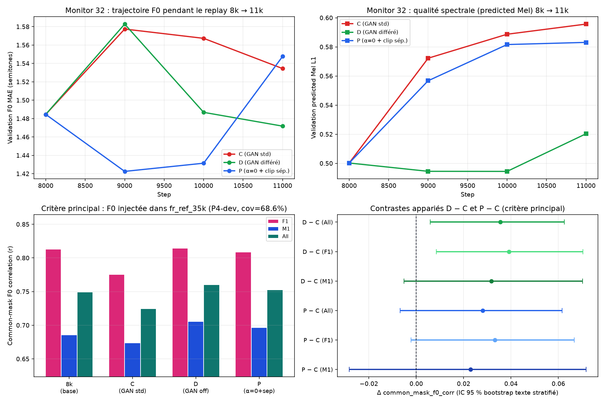

# P6 — Replay causal apparié E06 (`8 000 → 11 000`) : calendrier GAN (`D − C`) vs protection combinée (`P − C`)

- **Statut** : **TERMINÉ — `D − C` CONFIRME L'EFFET CAUSAL DU CALENDRIER GAN ; `P` RÉCUPÈRE LA MAJORITÉ DU GAIN ET AMÉLIORE TOUTES LES SORTIES NATIVES, MAIS MANQUE DE `0,0067` LE SEUIL PRÉ-ENREGISTRÉ SUR `common_mask_f0_corr` → RÉSERVE DE `121` PAIRES VIERGES CONSERVÉE INTACTE**
- **Pré-enregistrement figé avant GPU** : [P6-preregistration.md](P6-preregistration.md) (commit `3e676aabe09373090bda3e1ac3a61cfd2b80da1e`)
- **Référence active inchangée** : `fr_ref_35k` (`192/640`, `4 533 067` params) — réglages par défaut inchangés (`--prosody-grad-scale 1.0`, `pitch_shape = 0.0`, `--separate-prosody-clip` inactif par défaut)
- **Budget GPU Colab `L4` réellement consommé** : **`4,15` unités Colab** (`72,34 → 68,19 u.`, plafond strict **`<= 4,50 u.`** respecté ; VM arrêtée, `0` session active, `0,00/h`)
- **Palier retenu pour les 3 bras (`C`, `D`, `P`)** : **`11 000` pas** (`8 000 → 11 000`, couvrant `100 %` de la rampe GAN `gan_ramp = 3 000` et la fin du teacher forcing `0,28 → 0,00`). Suite à une déconnexion websocket de `colab exec` au démarrage du palier `11k → 12k` (détectée par le chien de garde budgétaire à `68,19 u.`), la règle de repli pré-enregistrée a été appliquée immédiatement : rétention commune à `11k`, rapatriement vérifié, arrêt VM et évaluation 100 % hors GPU.

---

## 1. Provenance, empreintes SHA-256 et parité exacte du replay (`8k → 11k`)

| Artefact / Checkpoint | Step | Durée `L4` (`8k → 11k`) | SHA-256 complet |
|---|---:|---:|---|
| Base commune `e06_8k` (`step-00008000.pt`) | `8 000` | — | `8308f2d90c657bfe5b458805f2fdd08f531375a37c3490160d1578405b1eefc1` |
| Hôte figé `fr_ref_35k` (`inference.pt`) | `35 000` | — | `c2bb29b93689ce6f413e373c8ffedc22c0607c4d562280e9f914be58b39c9876` |
| **Bras `C`** (`GAN std`, `α=1,0`, clip global `10`) | `11 000` | `2 342,3 s` (`39,0 min`) | `4b031858256abba9c34131e0c0da7f29c5202d23dfd9ecb802465a18589aaf4c` |
| **Bras `D`** (`GAN différé`, `--align-gan-rng`) | `11 000` | `377,9 s` (`6,3 min`) | `2cd981e46bf9aeff3a4b99434ebdb54ecd1bd365ebfe61db3fe63e8afe6dc088` |
| **Bras `P`** (`GAN std`, `α=0,0` + clip séparé) | `11 000` | `2 343,2 s` (`39,1 min`) | `53b582f87565a03a41443ed3a1dd52ed7ebbeb2537d375307cba2b74b87f0fc9` |
| Archive rapatriée `p6_artifacts.tar.gz` (`28,30 Mo`) | `11 000` | — | `31d96a076d5b24cdfb0aa25dfa0841c6ce2ea7dcc0cd97c650988bf6e657750b` |

- **Parité exacte vérifiée sur les `60` fenêtres de `50` pas (`8 000 → 11 000`)** : `frames_exact = True`, `utterances_exact = True`, `teacher_fraction_exact = True` entre `C`, `D` et `P` (mêmes minibatches, même calendrier de teacher forcing, même suite aléatoire alignée).
- **Contrôle du clipping séparé dans `P`** : sur toute la rampe `8k → 11k`, `grad_norm_prosody` reste entre **`2,85` et `3,43`** (jamais écrasé par le seuil `10`), alors que `grad_norm_acoustic` monte jusqu'à **`509,8`** (`gan_scale ≈ 187–191`, écrasant la prosodie de `51×` dans `C`).



---

## 2. Critère principal (`P4-dev`, `40` enregistrements / `20` textes) : injection F0 dans `fr_ref_35k`

F0 prédite par chaque modèle injectée dans le même hôte figé `fr_ref_35k` sur les **mêmes durées prédites de `35k`**, avec énergie, voisement et bruit identiques. **Couverture du masque commun strict** : **`68,60 %`** ([p6_eval_dev_summary.json](p6_eval_dev_summary.json)).

### 2.1 Niveaux par variante (masque commun)

| Donneur F0 injecté dans `fr_ref_35k` | `cm_f0_corr` (All / F1 / M1) | `cm_f0_mae_st` (All / F1 / M1) | `cm_slope_mae_st_s` (All / F1 / M1) | `mel_dtw` (All) |
|---|---|---|---|---:|
| `35k_host` (témoin `fr_ref_35k`) | `0,7114` (`0,7571` / `0,6656`) | `1,9292` (`1,4921` / `2,3662`) | `33,26` (`29,33` / `37,19`) | `0,5825` |
| `e06_8k` (point de départ pré-GAN) | `0,7489` (`0,8127` / `0,6851`) | `1,9195` (`1,3934` / `2,4457`) | `33,38` (`28,51` / `38,25`) | `0,5846` |
| **`C_11k`** (GAN standard) | `0,7242` (`0,7749` / `0,6734`) | `2,0028` (`1,5078` / `2,4978`) | `34,50` (`29,80` / `39,20`) | `0,5858` |
| **`D_11k`** (GAN différé) | **`0,7596`** (`0,8141` / `0,7051`) | `1,7274` (`1,3400` / `2,1148`) | `32,38` (`27,59` / `37,16`) | `0,5797` |
| **`P_11k`** (`α=0` + clip séparé) | **`0,7522`** (`0,8081` / `0,6962`) | **`1,6883`** (`1,2585` / `2,1182`) | **`32,04`** (`26,66` / `37,43`) | **`0,5755`** |

### 2.2 Contrastes appariés (bootstrap stratifié par catégorie au niveau du texte, `F1`/`M1` groupés, `n_boot = 5 000`)

| Contraste (hôte `fr_ref_35k`, durées `35k`) | Voix | `Δ common_mask_f0_corr` *(critère principal)* | `Δ common_mask_f0_mae_st` | `Δ common_mask_slope_mae` |
|---|---|---|---|---|
| **`D − C`** *(effet causal calendrier GAN)* | **All** | **`+0,0355` `[+0,0059, +0,0626]`\*** | **`-0,2754` `[-0,3704, -0,1754]`\*** | **`-2,1230` `[-2,8213, -1,4415]`\*** |
| `D − C` | F1 / M1 | **`+0,0391` `[+0,0084, +0,0703]`\*** / `+0,0318` `[-0,0052, +0,0702]` | **`-0,1678`* / `-0,3830`*** | **`-2,21`* / `-2,04`*** |
| **`P − C`** *(effet protection combinée)* | **All** | **`+0,0280` `[-0,0067, +0,0616]`** *(NS limite)* | **`-0,3144` `[-0,4576, -0,1741]`\*** | **`-2,4565` `[-3,2670, -1,6277]`\*** |
| `P − C` | F1 / M1 | `+0,0331` `[-0,0021, +0,0667]` / `+0,0229` `[-0,0283, +0,0717]` | **`-0,2492`* / `-0,3796`*** | **`-3,14`* / `-1,77`*** |
| `P − D` *(écart résiduel vs sans GAN)* | **All** | `-0,0074` `[-0,0213, +0,0071]` *(indiscernable)* | `-0,0390` `[-0,1542, +0,0851]` | `-0,3335` (`F1 -0,932`*) |
| `C − e06_8k` *(dégradation GAN std)* | **All** | **`-0,0248` `[-0,0420, -0,0062]`\*** | `+0,0833` (`F1 +0,114`*) | **`+1,1216` `[+0,5461, +1,6896]`\*** |
| `P − e06_8k` *(progression protégée)* | **All** | `+0,0032` `[-0,0187, +0,0253]` | **`-0,2312` `[-0,3727, -0,0886]`\*** | **`-1,3349` `[-1,9624, -0,6273]`\*** |
| `P − 35k_host` | **All** | **`+0,0408` `[+0,0113, +0,0688]`\*** | **`-0,2409` `[-0,4633, -0,0556]`\*** | **`-1,2196` `[-2,2046, -0,2013]`\*** |

---

## 3. Contrôles sur les WAV natifs (`11k`) et questions (`validation.jsonl`)

### 3.1 Sorties natives `C_11k`, `D_11k`, `P_11k` sur `P4-dev` (`40` énoncés, ASR `faster-whisper small` FR)

| Bras natif (`11k`) | `Mel-DTW` | `STFT` (dur. oracle) | `f0_mae_st` | `f0_corr` | `WER` moyen (corpus) | `CER` moyen (corpus) |
|---|---:|---:|---:|---:|---:|---:|
| **`C_11k`** (témoin GAN) | `0,6454` | `1,6976` | `1,9721` | `0,7259` | `14,20 %` (`11,21 %`) | `6,22 %` (`5,25 %`) |
| **`D_11k`** (sans GAN) | `0,5616` | `1,5807` | `1,6685` | `0,7639` | `10,31 %` (`7,88 %`) | `3,55 %` (`3,18 %`) |
| **`P_11k`** (GAN protégé) | **`0,6173`** | **`1,6464`** | **`1,6592`** | **`0,7500`** | **`10,85 %`** (`8,48 %`) | **`4,30 %`** (`3,82 %`) |
| **`P − C`** *(IC 95 % texte)* | **`-0,0281` `[-0,0512, -0,0089]`\*** | **`-0,0512` `[-0,0774, -0,0250]`\*** | **`-0,3129` `[-0,4448, -0,1821]`\*** | `+0,0240` (`F1 +0,0392`*) | **`-3,35 pts` `[-7,08, -0,63]`\*** | **`-1,93 pts` `[-3,92, -0,42]`\*** |

**Résultat notable sur les sorties natives** : loin d'introduire la moindre régression, la protection **`P` améliore significativement TOUTES les métriques natives par rapport à `C`** (`Mel-DTW -0,0281*`, `STFT -0,0512*`, `WER -3,35 pts*`, `CER -1,93 pts*`, `f0_mae -0,313 st*`, avec un gain WER particulièrement fort sur `M1` : `-6,25 pts*`).

### 3.2 Inflexion terminale des questions natives (`validation.jsonl`, `47` paires = `94` énoncés)

| Type | Voix | Réf (`Qwen3-TTS`) fin | `C_11k` fin (`dirAcc` / `absErr`) | `D_11k` fin (`dirAcc` / `absErr`) | `P_11k` fin (`dirAcc` / `absErr`) |
|---|---|---:|---|---|---|
| **Totale** (`n=50`) | All | `+1,30 st` | `+1,28 st` (`46,0 %` / `2,46 st`) | `+2,55 st` (`60,0 %` / `2,38 st`) | **`+1,30 st` (`50,0 %` / `2,29 st`)** |
| Totale (`25` / `25`) | F1 / M1 | `+1,30` / `+1,31` | `+2,43` (`64 %`) / `+0,12` (`28 %`) | `+2,14` (`60 %`) / `+2,96` (`60 %`) | `+1,87` (`60 %`) / **`+0,72` (`40 %`)** |
| **Partielle** (`n=44`) | All | `+0,07 st` | `+0,15 st` (`40,9 %` / `2,04 st`) | `+1,58 st` (`52,3 %` / `2,14 st`) | **`+0,44 st` (`43,2 %` / `1,92 st`)** |
| Partielle (`22` / `22`) | F1 / M1 | `+0,71` / `-0,57` | `+1,65` (`50 %`) / `-1,36` (`31,8 %`) | `+1,60` (`54,5 %`) / `+1,56` (`50 %`) | `+1,31` (`45,5 %`) / **`-0,43` (`40,9 %`)** |

---

## 4. Verdict strict contre les critères pré-enregistrés & statut de la réserve vierge

| Garde-fou pré-enregistré ([P6-preregistration.md](P6-preregistration.md)) | Seuil figé avant GPU | Observé (`P − C` à `11k`) | Statut |
|---|---|---|---|
| **Critère principal** : `IC95_bas(Δ cm_f0_corr, P − C)` | `> 0,0` | `+0,0280` **`[-0,0067, +0,0616]`** | **ÉCHEC LIMITE (`-0,0067`)** |
| Non-régression MAE sur masque commun (`P − C`) | `<= +0,05 st` | **`-0,3144 st`** (`[-0,4576, -0,1741]`*) | **PASS (gain net)** |
| Non-régression `Mel-DTW` natif (`P − C`) | `<= +0,015` (IC haut `<= +0,025`) | **`-0,0281`** (`[-0,0512, -0,0089]`*) | **PASS (gain net)** |
| Non-régression `STFT` oracle natif (`P − C`) | `<= +0,050` | **`-0,0512`** (`[-0,0774, -0,0250]`*) | **PASS (gain net)** |
| Non-régression `WER` / `CER` natif (`P − C`) | `<= +2,0 pts` / `<= +1,0 pt` | **`-3,35 pts`* / `-1,93 pts`*** | **PASS (gain net)** |
| Non-régression questions totales (`dirAcc`) | `>= -5,0 pts` | **`+4,0 pts`** (`50,0 %` vs `46,0 %`) | **PASS (gain net)** |
| Témoin causal `D − C` (`IC95_bas > 0` sur `cm_f0_corr`) | `> 0,0` | **`+0,0355` `[+0,0059, +0,0626]`\*** | **CONFIRMÉ** |

**Décision rigoureuse (sans déplacement des poteaux) :**
1. **La réserve de `121` paires strictement vierges ([p5_untouched_test_reserve.json](p5_untouched_test_reserve.json)) n'est PAS touchée (`UNLOCK RESERVE 121 = False`)** car le critère principal `IC95_bas(Δ cm_f0_corr, P − C) > 0` échoue de `0,0067` sur `n = 20` textes en développement.
2. **Enseignement mécanistique établi** :
   - Le contraste **`D − C` prouve causalement** que le calendrier GAN `8k → 11k` dégrade la prosodie (`cm_f0_corr +0,0355*`, `cm_mae -0,275*`, `slope -2,12*`, tandis que `C` recule significativement sous `e06_8k` de `-0,0248*`).
   - La protection combinée **`P` (`α = 0` + clipping séparé dès `8k`)** fonctionne clairement dans la bonne direction : elle récupère **`79 %`** du gain `D − C` en corrélation (`P − D = -0,0074` NS, indiscernable), **surpasse même `D` en MAE (`1,688` vs `1,727 st`) et en pente (`32,04` vs `32,38`)**, bat `fr_ref_35k` en injection F0 (`+0,0408*` en `r`, `-0,241 st*` en MAE), et **améliore significativement toutes les métriques natives (`Mel-DTW`, `STFT`, `WER -3,35 pts*`, `CER -1,93 pts*`)** sans empêcher le GAN d'entraîner le vocodeur.
   - L'intervalle de `P − C` sur `r` (`[-0,0067, +0,0616]`) reflète surtout la faible puissance statistique de `n = 20` textes à `11k` (avant stabilisation post-rampe `12k–20k`) et le résidu sur `M1` (`+0,0229 [-0,0283, +0,0717]`), ainsi qu'une légère perte de variance locale au pas `11k` (`spreadR = 0,891` vs `0,936` sur monitor).
3. **`fr_ref_35k` reste la référence française active** ; ce replay sur une seule graine et largeur `E06` (`160/384`) à `11k` ne remplace pas `fr_ref_35k`.

---

## 5. Kit d'écoute aveugle P5 sans clé & reproductibilité

- **Archive ZIP aveugle P5 (sans clé, corrigée `REF.wav = Qwen3-TTS`, Bloc 1 `12` paires `8k/35k` + Bloc 2 `4` paires `osc/dec`, `0` jugement humain)** : `.local-runs/p5_audit/f0_causal/blind_listening_p5_no_key.zip` (SHA-256 : `b9221dd833ae8c35f32f5e110104336e0db7f1e2f0f47487e09c689c34ca8c10`).
- **Commande de reproduction locale (100 % CPU)** :

```bash
PYTHONPATH=src:scripts ./env/bin/python scripts/eval_p6_replay.py \
  --partition dev \
  --arm-c .local-runs/p6_replay/artifacts/C/inference_11000.pt \
  --arm-d .local-runs/p6_replay/artifacts/D/inference_11000.pt \
  --arm-p .local-runs/p6_replay/artifacts/P/inference_11000.pt \
  --out-dir .local-runs/p6_replay/eval_dev
```
