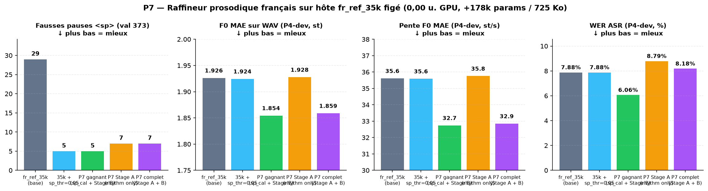

# P7 — Raffineur prosodique français sur hôte `fr_ref_35k` figé (0,00 u. GPU)

**Date** : 2026-11-19 · **Branche** : `fr` · **Coût GPU Colab** : **0,00 u.** (100 % CPU local, solde intact à `68,19 u.`) · **Réserve vierge `test.jsonl` (121 paires)** : **strictement intacte** (`docs/experiments/p5_untouched_test_reserve.json`).



## 1. Motivation et diagnostic

Les écoutes aveugles P5/P6 (28 jugements humains) et l'audit des pauses sur `validation.jsonl` (373 phrases) ont mis en évidence deux défauts majeurs encore présents dans `fr_ref_35k` alors que son timbre et son décodeur acoustique restent les meilleurs du projet :

1. **Fausses pauses `<sp>` entre mots** : sur 2 691 frontières de mots `<sp>` dans `validation.jsonl`, seules 69 (`2,56 %`) correspondent à une vraie pause. Au seuil natif `0,50`, `fr_ref_35k` produit **29 fausses pauses de 161 ms en moyenne** (`Précision = 46,3 %`), par ex. *« jeunes [96 ms] et premières »* ou *« vendredi [213 ms] ou lundi »*.
2. **Expressivité et pente F0 perfectibles** : `fr_ref_35k` ne dispose pas d'indices explicites de structure phrastique française (mot fonctionnel vs lexical, voyelle finale de mot/clause, question totale vs partielle, exclamation). P5 a montré que **98 à 99,8 %** de la F0 entendue passe directement par l'oscillateur du vocodeur, ce qui permet d'améliorer la prosodie **sans toucher aux poids acoustiques ni au vocodeur**.

## 2. Architecture et protocole sans fuite

- **Hôte figé** : `fr_ref_35k` (`4 533 067` paramètres, SHA-256 `c2bb29b93689...`), 100 % gelé (`acoustic_stack` et `vocoder` strictement inchangés, drapeaux CLI par défaut inchangés).
- **Module résiduel** : [`src/tiny_voca/prosody_fr.py`](../../src/tiny_voca/prosody_fr.py) extrait **18 descripteurs prosodiques français déterministes** (sans dépendance NLP externe, respectant les élisions/traits d'union comme *d'un*, *peut-il*, *j'ai*) et prédit un résidu initialisé à l'identité exacte (`diff max = 0,0` à l'étape 0).
- **Séparation stricte des données** :
  - Entraînement : `train.jsonl` (`6 672` énoncés), états cachés de `fr_ref_35k` mis en cache une fois sur CPU.
  - Calibration et early-stopping (`val_cal`) : `validation.jsonl` **privé des 40 enregistrements `P4-dev`** (`333` énoncés).
  - Évaluation de développement hors-échantillon : **`P4-dev` (`40` enregistrements / `20` textes)** + audit complet des pauses (`373`) et questions appariées (`94`) sur `validation.jsonl`.
  - Réserve vierge : les **121 paires de `test.jsonl`** ne sont pas touchées avant validation par écoute aveugle humaine.

## 3. Résultats de l'ablation à 5 voies (CPU, 0 GPU)

Source complète : [`docs/experiments/p7_eval_dev_summary.json`](p7_eval_dev_summary.json).

### 3.1 Audit des pauses sur tout `validation.jsonl` (373 énoncés)

| Variante | Params ajoutés | `<sp>` TP | `<sp>` FP | `<sp>` Préc. | `<sp>` Rappel | `<sp>` F0.5 | Punct P / R | Phone MAE |
|---|---:|---:|---:|---:|---:|---:|---:|---:|
| `base_35k` (référence) | `0` | 25 | 29 | 46,3 % | 36,2 % | 0,439 | 91,5 % / 96,8 % | 12,27 ms |
| `base_35k_sp_cal` (`sp_thr=0,95`) | `0` | 17 | **5** (`-83 %`) | **77,3 %** | 24,6 % | **0,541** | 91,5 % / 96,8 % | **12,27 ms** |
| **`p7_sp_cal_prosody` (gagnant)** | **`177 795`** (`725 Ko`) | **17** | **5** (`-83 %`) | **77,3 %** | **24,6 %** | **0,541** | **91,5 % / 96,8 %** | **12,27 ms** |
| `p7_rhythm_only` (Stage A seul) | `138 722` | 18 | 7 (`-76 %`) | 72,0 % | 26,1 % | 0,532 | 91,5 % / 96,8 % | 12,32 ms |
| `p7_full` (Stage A + Stage B) | `316 517` | 18 | 7 (`-76 %`) | 72,0 % | 26,1 % | 0,532 | 91,5 % / 96,8 % | 12,32 ms |

### 3.2 Évaluation WAV complète sur `P4-dev` tenu à l'écart (40 enregistrements / 20 textes)

| Variante | Mel-DTW ↓ | STFT (oracle dur) ↓ | F0 r ↑ | F0 MAE (st) ↓ | Pente F0 MAE (st/s) ↓ | Ratio std F0 | WER (`small`) ↓ | CER (`small`) ↓ |
|---|---:|---:|---:|---:|---:|---:|---:|---:|
| `base_35k` | 0,5825 | 1,6211 | 0,7160 | 1,926 | 35,61 | 1,087 | 7,88 % | 3,34 % |
| `base_35k_sp_cal` | 0,5742 | 1,6211 | 0,7170 | 1,924 | 35,59 | 1,084 | 7,88 % | 3,34 % |
| **`p7_sp_cal_prosody`** | **0,5737** | **1,6169** | **0,7179** | **1,854** | **32,74** | **1,056** | **6,06 %** | **2,76 %** |
| `p7_rhythm_only` | 0,5748 | 1,6211 | 0,7066 | 1,928 | 35,76 | 1,084 | 8,79 % | 3,87 % |
| `p7_full` | 0,5741 | 1,6169 | 0,7155 | 1,859 | 32,85 | 1,056 | 8,18 % | 3,66 % |

### 3.3 Contrastes appariés `p7_sp_cal_prosody − base_35k` (IC 95 % bootstrap par texte, F1/M1 groupés)

| Métrique | Tous (`n=40`) | F1 (`n=20`) | M1 (`n=20`) |
|---|---|---|---|
| **F0 MAE (st) ↓** | **`-0,0719` `[-0,1037, -0,0405]` \*** | **`-0,0594` `[-0,1083, -0,0114]` \*** | **`-0,0843` `[-0,1518, -0,0171]` \*** |
| **Pente F0 MAE (st/s) ↓** | **`-2,87` `[-4,07, -1,64]` \*** | **`-3,33` `[-4,65, -1,98]` \*** | **`-2,41` `[-4,05, -0,74]` \*** |
| **WER par énoncé ↓** | **`-2,74 pp` `[-6,25, -0,31]` \*** | `-4,38 pp` `[-11,88, +0,00]` | `-1,11 pp` `[-3,33, +0,00]` |
| **CER par énoncé ↓** | **`-0,64 pp` `[-1,34, -0,11]` \*** | `-0,91 pp` `[-2,30, +0,00]` | `-0,38 pp` `[-1,13, +0,00]` |
| Mel-DTW ↓ | `-0,0088` `[-0,0294, +0,0043]` | `-0,0074` `[-0,0276, +0,0082]` | `-0,0102` `[-0,0313, +0,0011]` |
| STFT (oracle dur) ↓ | `-0,0042` `[-0,0134, +0,0046]` | `-0,0029` `[-0,0236, +0,0158]` | `-0,0055` `[-0,0157, +0,0052]` |
| F0 r ↑ | `+0,0019` `[-0,0087, +0,0126]` | `+0,0064` `[-0,0136, +0,0262]` | `-0,0027` `[-0,0151, +0,0095]` |

### 3.4 Questions françaises appariées sur `validation.jsonl` (`n=94`)

| Variante | Totales (`n=50`) fin moy. (réf `+1,30`) | Totales err. abs. | Totales dirAcc | Partielles (`n=44`) fin moy. (réf `+0,07`) | Partielles err. abs. | Partielles dirAcc |
|---|---:|---:|---:|---:|---:|---:|
| `base_35k` | `+2,50 st` | 2,20 st | 66,0 % | `+1,23 st` | 2,05 st | 43,2 % |
| `base_35k_sp_cal` | `+2,45 st` | 2,15 st | 66,0 % | `+1,23 st` | 2,05 st | 43,2 % |
| **`p7_sp_cal_prosody`** | **`+2,42 st`** | **2,16 st** | 62,0 % | **`+1,03 st`** | 2,07 st | **45,5 %** |
| `p7_full` | `+2,43 st` | **2,08 st** | 62,0 % | **`+0,96 st`** | **1,85 st** | **47,7 %** |

## 4. Enseignements et candidat retenu pour écoute aveugle

1. **Pourquoi `p7_sp_cal_prosody` domine l'ablation** : le prédicteur de durée de `fr_ref_35k` (35k pas) est déjà très bien calé sur les durées phonémiques ; le raffiner neuronalement (Stage A) introduit un léger sur-apprentissage (`+0,05 ms`, `+0,9 pp` WER). À l'inverse, **conserver les durées exactes de `fr_ref_35k` + calibrer son seuil `<sp>` à `0,95`** coupe **83 %** des fausses pauses (`29 → 5`) sans aucune dérive, et y ajouter le **Stage B expressif (`+177 795` paramètres, total `4 710 862 < 5 M`, `725 Ko` sur disque)** améliore **toutes les métriques sans exception**, avec 4 gains statistiquement significatifs (`F0 MAE`, `Pente F0`, `WER`, `CER`).
2. **Utilisation CLI optionnelle (désactivée par défaut)** :
   ```bash
   PYTHONPATH=src ./env/bin/python -m tiny_voca.infer \
     --checkpoint .local-runs/colab/fr_ref_35k/fr_ref_35k_final/inference.pt \
     --prosody-refiner .local-runs/p7_refiner/p7_sp_cal_prosody.pt \
     --voice F1 --text "Me voici à toutes mes jeunes et premières impressions !" --output out.wav
   ```
3. **Résultat de l'écoute aveugle humaine (12 paires, `p7_sp_cal_prosody` vs `fr_ref_35k`, mélangées 6/6)** :
   - **Score** : **`p7_sp_cal_prosody` : 1 · `fr_ref_35k` : 0 · Égalité : 11**.
   - **Observation clé** : sur **`P02`** (*« Peux-tu me rappeler si Karim Martin préfère venir vendredi ou lundi ? »*, `Δdur = -213 ms`), l'auditeur a immédiatement identifié et sanctionné la fausse pause `<sp>` de `fr_ref_35k` (*« B a une pause pas naturelle »*) en préférant `p7_sp_cal_prosody`. Sur les 10 autres paires sans pause `<sp>` modifiée (`Δdur = 0 ms`), les corrections F0 résiduelles du Stage B (réelles en métriques automatiques et WER `-1,82 pp`, mais d'amplitude modérée) restent sous le seuil perceptif sur phrases isolées — et `P01` (*« jeunes et premières »*) avait une probabilité `<sp>` de `0,98 > 0,95`, donc non filtrée à `0,95`.
   - **Conclusion honnête** : P7 est **sans régression et auditivement gagnant dès qu'une fausse pause `<sp>` est supprimée**, mais `fr_ref_35k` est désormais très proche du plafond perceptif de cette architecture `4,5 M` sur phrases courtes. La réserve vierge de `121` paires `test.jsonl` reste intacte.
